# Лабораторная работа №3. Облачные сети. Amazon VPC

## 1. Общая информация

**ФИО:** Codjebas Oleg **Группа:** IA2403 **Специальность:** Informatică aplicată (IA) **Выбранный уровень:** базовый (Часть 1, задания 1-7) **AWS Region:** `eu-central-1 (Frankfurt)`

**Номер k:** 9, поэтому X = 9 % 30 = 9, диапазон VPC `10.9.0.0/16`. **Owner:** `CloudStudent`.

---

## 2. Цель работы

Научиться строить собственную сеть в AWS: разбивать адресное пространство на подсети, настраивать маршрутизацию, выход в интернет и фильтрацию трафика, а также разместить базу данных в приватной подсети, куда из интернета нет дороги.

---

## 3. Задание 1. План адресов

Для k = 9 получаем X = 9. Адреса, доступные экземплярам, это все адреса подсети, кроме пяти зарезервированных AWS.

| Подсеть | Зона доступности | Диапазон | Первый и последний адрес, доступный экземплярам | Сколько адресов доступно |
| --- | --- | --- | --- | --- |
| public-a | eu-central-1a | `10.9.0.0/24` | `10.9.0.4` - `10.9.0.254` | 251 |
| public-b | eu-central-1b | `10.9.1.0/24` | `10.9.1.4` - `10.9.1.254` | 251 |
| private-a | eu-central-1a | `10.9.10.0/24` | `10.9.10.4` - `10.9.10.254` | 251 |
| private-b | eu-central-1b | `10.9.11.0/24` | `10.9.11.4` - `10.9.11.254` | 251 |

### Контрольные вопросы

**Почему доступных адресов не 256? Какие адреса подсети 10.X.0.0/24 занимает AWS и для чего? Сколько ещё подсетей /24 поместится в вашу VPC?**

В каждой подсети AWS резервирует 5 адресов, поэтому из 256 остаётся 251. Для подсети `10.9.0.0/24` это:

- `10.9.0.0` - адрес сети;
- `10.9.0.1` - виртуальный маршрутизатор VPC;
- `10.9.0.2` - DNS-сервер VPC;
- `10.9.0.3` - зарезервирован AWS для будущего использования;
- `10.9.0.255` - широковещательный адрес (в VPC broadcast не поддерживается, но адрес всё равно занят).

В VPC `10.9.0.0/16` помещается 256 подсетей /24. Четыре уже созданы, значит, ещё поместится 252.

---

## 4. Задание 2. VPC и подсети

Создана VPC `timecapsule-dev-vpc` (`vpc-0c1bed881ab4155fd`) с диапазоном `10.9.0.0/16` без IPv6, способ создания VPC only. У VPC включены `Enable DNS resolution` и `Enable DNS hostnames`. Затем созданы четыре подсети из таблицы задания 1: `timecapsule-dev-public-a`, `timecapsule-dev-public-b`, `timecapsule-dev-private-a`, `timecapsule-dev-private-b`. На все ресурсы добавлены теги `Name`, `Project=timecapsule`, `Environment=dev`, `Owner=CloudStudent`, `Lab=lab3`. Созданные VPC и подсети видны в списке ресурсов с тегами в конце работы (рисунок 18).

### Контрольный вопрос

**Является ли подсеть public-a сейчас публичной? Почему?**

Нет. Подсеть считается публичной, когда в её таблице маршрутов есть маршрут `0.0.0.0/0` в Internet Gateway. Сейчас у подсети нет такого маршрута (и самого шлюза ещё нет), она связана только с основной таблицей, где есть лишь локальный маршрут внутри VPC. Название `public-a` ничего не значит.

---

## 5. Задание 3. Internet Gateway и таблицы маршрутов

Создан Internet Gateway `timecapsule-dev-igw` и подключён к VPC (состояние Attached). Создана таблица `timecapsule-dev-public-rt` с маршрутом `0.0.0.0/0` → `timecapsule-dev-igw`, она связана с `public-a` и `public-b`. Таблица `timecapsule-dev-private-rt` (`rtb-0e9f659049037c867`) создана без дополнительных маршрутов и связана с `private-a` и `private-b`. Для `public-a` и `public-b` включена опция `Enable auto-assign public IPv4 address`.

[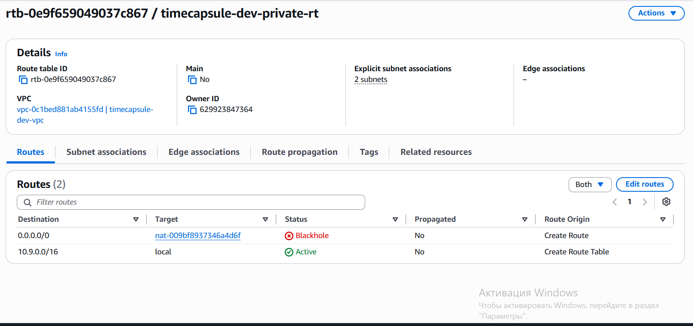](lab3/01-private-rt-local.png)

*Рисунок 1 — Таблица `timecapsule-dev-private-rt`: локальный маршрут `10.9.0.0/16 → local` и две связанные подсети (маршрут `0.0.0.0/0` в Blackhole появился позже, после удаления NAT Gateway)*

### Контрольный вопрос

**Какой маршрут есть в обеих таблицах, хотя вы его не добавляли? Что он даёт? Куда уйдёт пакет из private-a, адресованный 8.8.8.8?**

В обеих таблицах есть локальный маршрут `10.9.0.0/16 → local` (виден на рисунке 1). AWS добавляет его автоматически, и удалить его нельзя. Он обеспечивает связь между всеми подсетями VPC, в том числе между разными зонами доступности. Пакет из `private-a` на `8.8.8.8` не подходит под локальный маршрут, а других маршрутов в `private-rt` нет, поэтому он никуда не уйдёт и будет отброшен.

---

## 6. Задание 4. Security Group

В VPC `timecapsule-dev-vpc` созданы три группы (исходящие правила по умолчанию):

| Группа | Входящее правило | Источник |
| --- | --- | --- |
| `timecapsule-dev-bastion-sg` | SSH (22) | My IP |
| `timecapsule-dev-web-sg` | HTTP (80) | `0.0.0.0/0` |
| `timecapsule-dev-web-sg` | SSH (22) | `bastion-sg` |
| `timecapsule-dev-db-sg` | PostgreSQL (5432) | `web-sg` |
| `timecapsule-dev-db-sg` | SSH (22) | `bastion-sg` |

Группы были созданы по порядку: `bastion-sg`, `web-sg`, `db-sg`, так как группу можно выбрать источником только после её создания. Работу правил показывают проверки в задании 7 (рисунки 11 и 12).

### Контрольный вопрос

**Почему в db-sg источником указана группа web-sg, а не адрес веб-сервера или диапазон 10.X.0.0/16?**

Группа в качестве источника означает «любой экземпляр, у которого есть эта группа». Если веб-сервер пересоздадут или добавят второй, правило менять не придётся, а с адресом пришлось бы. Диапазон `10.9.0.0/16` слишком широкий: он пустил бы к базе все серверы VPC, в том числе bastion и любые будущие машины. Так работает принцип наименьших привилегий: к базе подключается только тот, кому это нужно.

---

## 7. Задание 5. Экземпляры

Запущены три экземпляра Amazon Linux 2023 (`t3.micro`, ключ `Codjebas-keypair`), у всех добавлены обязательные теги для Instances и Volumes:

| Роль | Имя | ID | Подсеть | Приватный IP | Публичный IP | Security Group |
| --- | --- | --- | --- | --- | --- | --- |
| bastion | `timecapsule-dev-bastion` | `i-051dfaaf5ab865b86` | public-b | `10.9.1.103` | `3.127.152.156` | bastion-sg |
| web-server | `timecapsule-dev-web` | `i-07cd55cafe3f33321` | public-a | `10.9.0.253` | `3.71.87.189` | web-sg |
| db-server | `timecapsule-dev-db` | `i-07106ccb244588a75` | private-a | `10.9.10.100` | нет | db-sg |

На web-server в User data передан скрипт установки nginx, который записывает на главную страницу имя сервера и его адрес:

```
#!/bin/bash
dnf -y install nginx
echo "<h1>$(hostname)</h1><p>$(hostname -I)</p>" > /usr/share/nginx/html/index.html
systemctl enable --now nginx
```

Сайт по адресу `http://3.71.87.189` открывается. На странице видны имя `ip-10-9-0-253.eu-central-1.compute.internal` и приватный адрес `10.9.0.253` из диапазона `10.9.0.0/24`.

[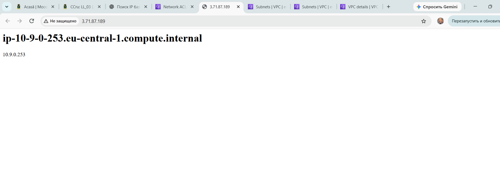](lab3/02-site-nginx.png)

*Рисунок 2 — Сайт на web-server: имя сервера и приватный адрес из подсети public-a*

### Подключение через bastion

В файле `C:\Users\user\.ssh\config` описаны хосты `bastion`, `web` и `db`. Для `web` и `db` указан `ProxyJump bastion`, в `HostName` стоят приватные адреса `10.9.0.253` и `10.9.10.100`. Приватный ключ остаётся на локальном компьютере и на bastion не копируется. Подключение командами `ssh bastion`, `ssh web` и `ssh db` работает. Подключение к web-server идёт через bastion: в сообщении `Last login` виден адрес `10.9.1.103`, то есть приватный адрес bastion. Подключение к db-server видно по приглашению `[ec2-user@ip-10-9-10-100 ~]$` на рисунках 5 и 6.

[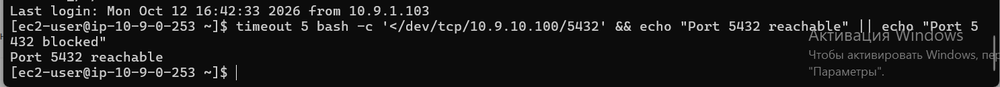](lab3/03-ssh-web.png)

*Рисунок 3 — Подключение к web-server (`ip-10-9-0-253`) через bastion; в `Last login` указан адрес bastion `10.9.1.103`*

Затем на db-server выполнена команда `sudo dnf -y install postgresql16-server`. Пакеты не скачались: команда зависла и была прервана по `Ctrl+C`.

### Контрольный вопрос

**Почему db-server не может скачать пакеты, хотя web-server это делает? Что нужно добавить в сеть, чтобы это стало возможно, и при этом db-server остался недоступным из интернета?**

У web-server есть публичный адрес и маршрут `0.0.0.0/0` в Internet Gateway, поэтому он выходит в интернет. У db-server нет ни публичного адреса, ни такого маршрута (в `private-rt` только локальный), и пакеты на него не доходят. Нужно добавить NAT Gateway в публичную подсеть и маршрут `0.0.0.0/0 → NAT Gateway` в `private-rt`. NAT пропускает только соединения, начатые изнутри, поэтому входящие соединения из интернета к db-server по-прежнему невозможны.

---

## 8. Задание 6. Временный NAT Gateway

Создан NAT Gateway `timecapsule-dev-nat-a` (`nat-009bf8937346a4d6f`) в подсети `public-a`, тип Public, режим Zonal, с новым Elastic IP `63.187.134.203`. Приватный адрес шлюза `10.9.0.48`. Elastic IP подписан тегами (`timecapsule-dev-nat-a-eip`). После перехода шлюза в Available в `private-rt` добавлен маршрут `0.0.0.0/0 → timecapsule-dev-nat-a`.

[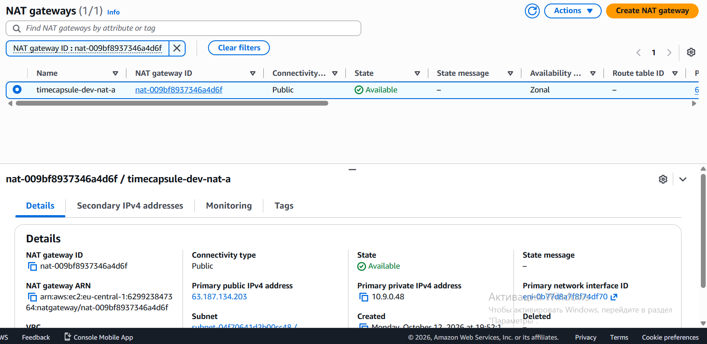](lab3/04-nat-available.png)

*Рисунок 4 — NAT Gateway `timecapsule-dev-nat-a` в состоянии Available (публичный адрес `63.187.134.203`)*

На db-server проверен внешний адрес и установлены пакеты:

```
curl https://checkip.amazonaws.com
sudo dnf -y update
sudo dnf -y install postgresql16-server
```

Команда `curl` вернула адрес `63.187.134.203`, то есть Elastic IP NAT Gateway. Пакеты установились.

Затем PostgreSQL настроен на приём подключений по сети (`X = 9`):

```
sudo postgresql-setup --initdb
sudo sed -i "s/^#listen_addresses = 'localhost'/listen_addresses = '*'/" /var/lib/pgsql/data/postgresql.conf
echo "host  all  all  10.9.0.0/24  scram-sha-256" | sudo tee -a /var/lib/pgsql/data/pg_hba.conf
sudo systemctl enable --now postgresql
sudo -u postgres psql -c "CREATE USER student WITH PASSWORD '...';"
sudo -u postgres psql -c "CREATE DATABASE lab3 OWNER student;"
```

Служба PostgreSQL запущена (`active (running)`, автозапуск включён). При первой попытке создать пользователя PostgreSQL вернул синтаксическую ошибку, потому что пароль был без кавычек. После исправления команда выполнилась (`CREATE ROLE`, `CREATE DATABASE`).

[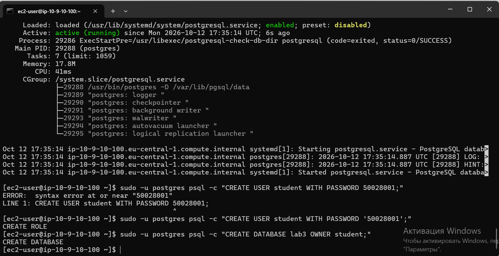](lab3/05-postgres-create-user.png)

*Рисунок 5 — Служба PostgreSQL запущена, созданы пользователь `student` и база `lab3`*

Проверка командами `sudo systemctl is-active postgresql`, `\du` и `\l`: служба `active`, есть роль `student`, база `lab3` с владельцем `student`.

[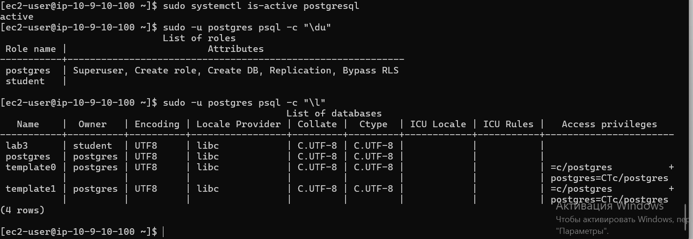](lab3/06-postgres-check.png)

*Рисунок 6 — Роли и базы данных PostgreSQL*

После установки NAT Gateway удалён (Actions → Delete NAT gateway).

[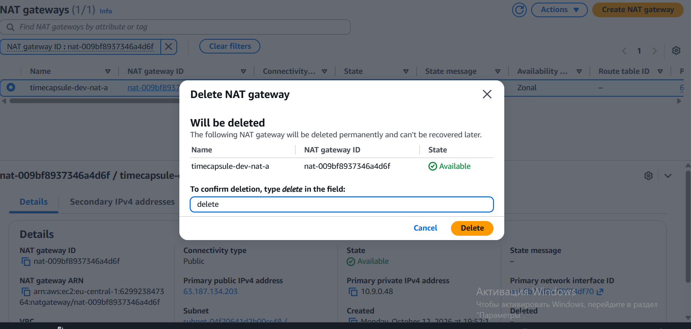](lab3/07-nat-delete.png)

*Рисунок 7 — Подтверждение удаления NAT Gateway*

Когда шлюз перешёл в состояние Deleted, маршрут `0.0.0.0/0` в `private-rt` получил статус Blackhole. Он был удалён.

[](lab3/08-route-blackhole.png)

*Рисунок 8 — Таблица `timecapsule-dev-private-rt`: маршрут `0.0.0.0/0` в состоянии Blackhole*

Затем освобождён Elastic IP шлюза (`63.187.134.203`), в списке Elastic IP адресов не осталось.

[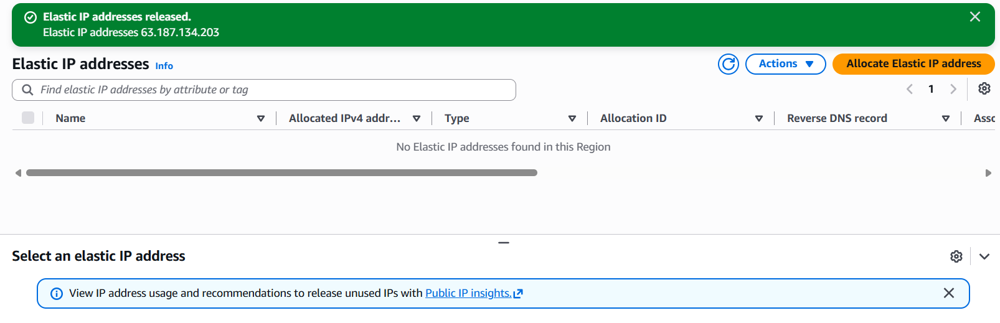](lab3/09-eip-released.png)

*Рисунок 9 — Elastic IP освобождён, платных адресов не осталось*

### Контрольные вопросы

**Какой адрес вернула первая команда? Сравните его с Elastic IP NAT Gateway. Почему это не адрес db-server?**

Команда вернула `63.187.134.203`, он совпадает с Elastic IP NAT Gateway (рисунок 4). У db-server собственного публичного адреса нет. NAT Gateway подменяет в исходящих пакетах приватный адрес `10.9.10.100` на свой Elastic IP, поэтому для внешнего мира все серверы приватной подсети выглядят как один адрес шлюза.

**Доступ к базе ограничивают три механизма. Что делает каждый из них? Что произойдёт, если ошибиться только в одном?**

1. **Нет публичного адреса и маршрута в Internet Gateway.** Из интернета до сервера просто нет пути.
2. **Security Group `db-sg`.** Это файрвол на уровне экземпляра: порт 5432 открыт только для `web-sg`, остальным соединение не пройдёт.
3. **`pg_hba.conf`.** Это правила самого PostgreSQL: с каких адресов, к каким базам и какими пользователями можно входить и как проверяется пароль. Разрешена только подсеть `10.9.0.0/24` с паролем `scram-sha-256`.

Если ошибиться в одном, остальные два всё равно защищают базу. Например, при слишком широком правиле в `db-sg` базе всё равно нужен путь из интернета и подходящая запись в `pg_hba.conf`. Это принцип «защиты в глубину».

**Почему PostgreSQL продолжает работать после удаления NAT Gateway? Что придётся сделать, когда на db-server понадобится установить обновления безопасности?**

Выход в интернет был нужен только для скачивания пакетов. Уже установленный PostgreSQL работает локально и принимает подключения от web-server по локальному маршруту VPC, NAT для этого не нужен. Для обновлений придётся снова создать NAT Gateway с Elastic IP, добавить маршрут в `private-rt`, установить обновления, а затем снова удалить шлюз, маршрут и освободить адрес.

---

## 9. Задание 7. Проверки

### Доступ к базе

На web-server установлен клиент (`sudo dnf -y install postgresql16`) и выполнено подключение к базе. После ввода пароля команда вернула версию `PostgreSQL 16.15`.

```
psql -h 10.9.10.100 -U student -d lab3 -c "SELECT version();"
```

[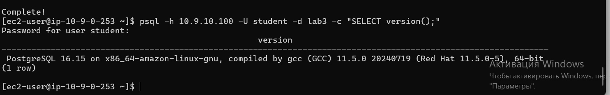](lab3/10-psql-version.png)

*Рисунок 10 — `SELECT version();` с web-server*

### Security Group в действии

С web-server порт 5432 открыт, с bastion закрыт:

```
timeout 5 bash -c '</dev/tcp/10.9.10.100/5432' && echo open || echo closed
```

[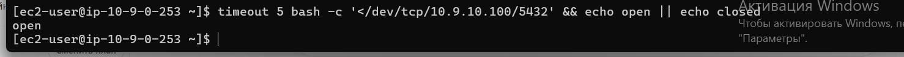](lab3/11-port-web-open.png)

*Рисунок 11 — Проверка порта с web-server (`10.9.0.253`): `open`*

[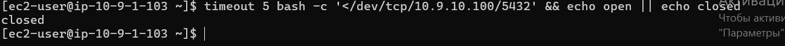](lab3/12-port-bastion-closed.png)

*Рисунок 12 — Проверка порта с bastion (`10.9.1.103`): `closed`*

**Почему с web-server порт открыт, а с bastion нет, хотя оба сервера в одной VPC и маршрут между ними есть?**

Маршрут только даёт пакетам путь, а пропускает их Security Group. В `db-sg` порт 5432 разрешён только для источника `web-sg`. Bastion состоит в `bastion-sg`, для него разрешения нет, и Security Group по умолчанию отбрасывает всё, что явно не разрешено. Поэтому соединение с bastion не устанавливается и по таймауту получается `closed`.

### Изоляция базы

С db-server выполнено `curl -m 5 https://github.com`. Запрос не прошёл: через 5 секунд curl завершился по таймауту, соединения с GitHub нет.

**Почему запрос не проходит? Можно ли из интернета подключиться к порту 5432 db-server? Объясните по цепочке: маршрут, адрес, фильтры.**

- **Маршрут.** NAT Gateway удалён, и в `private-rt` нет маршрута `0.0.0.0/0`, поэтому пакет на GitHub некуда отправить.
- **Адрес.** У db-server нет публичного адреса, поэтому из интернета его нельзя адресовать.
- **Фильтры.** Даже если бы пакет дошёл, `db-sg` пускает на 5432 только `web-sg`, а `pg_hba.conf` разрешает только подсеть `10.9.0.0/24`.

Из интернета подключиться к порту 5432 нельзя: нет маршрута, нет адреса, и фильтры тоже закрыты.

### Network ACL

Мой внешний адрес: `81.180.64.106`. В Network ACL по умолчанию VPC `timecapsule-dev-vpc` добавлено входящее правило: номер 90, All traffic, источник `81.180.64.106/32`, действие Deny (правило 100 Allow `0.0.0.0/0` осталось).

[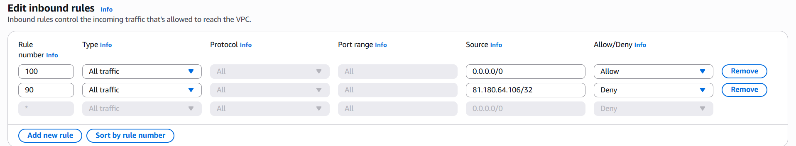](lab3/13-nacl-rule-90.png)

*Рисунок 13 — Правило 90 (Deny) в Network ACL*

После добавления правила `ssh bastion` завершается ошибкой `Connection timed out`, и сайт в браузере не открывается (`ERR_CONNECTION_TIMED_OUT`).

[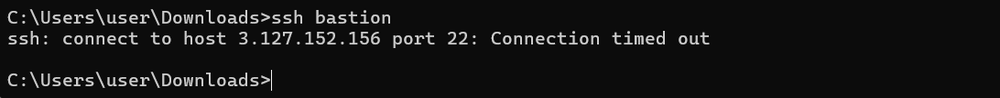](lab3/14-ssh-timeout.png)

*Рисунок 14 — `ssh bastion`: Connection timed out*

[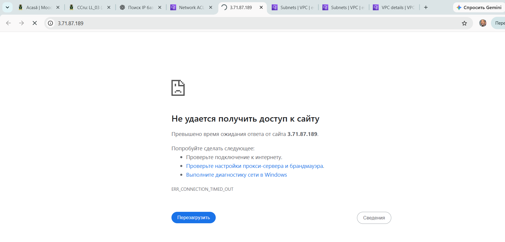](lab3/15-browser-timeout.png)

*Рисунок 15 — Сайт `http://3.71.87.189` не открывается с компьютера*

С телефона через мобильный интернет сайт открывается.

[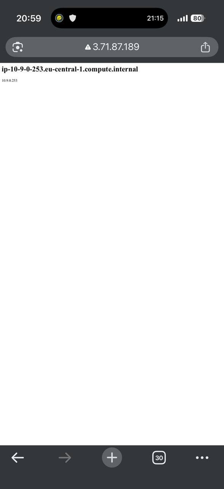](lab3/16-phone-site.jpg)

*Рисунок 16 — Сайт открывается с телефона через мобильный интернет*

После удаления правила 90 SSH и сайт снова работают.

[](lab3/17-site-after-rule-removed.png)

*Рисунок 17 — Сайт снова открывается с компьютера после удаления правила 90*

**Почему заблокировано и SSH, и сайт, хотя вы не меняли ни одной Security Group? Почему с телефона сайт открывается? Почему правило должно иметь номер меньше 100?**

Network ACL работает на границе подсети и проверяется раньше Security Group. Это Network ACL по умолчанию, она связана со всеми подсетями VPC, и правило Deny на мой адрес закрыло весь трафик к bastion (`public-b`) и к web-server (`public-a`). Правило не зависит от порта, поэтому пропали и SSH, и HTTP. С телефона запрос приходит с другого адреса (мобильный интернет), он не попадает под `/32` правила 90 и пропускается правилом 100. Правила ACL проверяются по возрастанию номеров, применяется первое подходящее. Если бы Deny имело номер больше 100, трафик сначала совпал бы с правилом 100 (Allow `0.0.0.0/0`), и запрет никогда бы не сработал.

### Имена и теги

В Resource Groups & Tag Editor выбран регион `eu-central-1`, тип ресурсов All supported resource types, тег `Project = timecapsule`. Найдено 18 ресурсов (VPC, подсети, Internet Gateway, таблицы маршрутов, Security Group, экземпляры и их диски, NAT Gateway). Ресурсы без тегов были дополнены.

[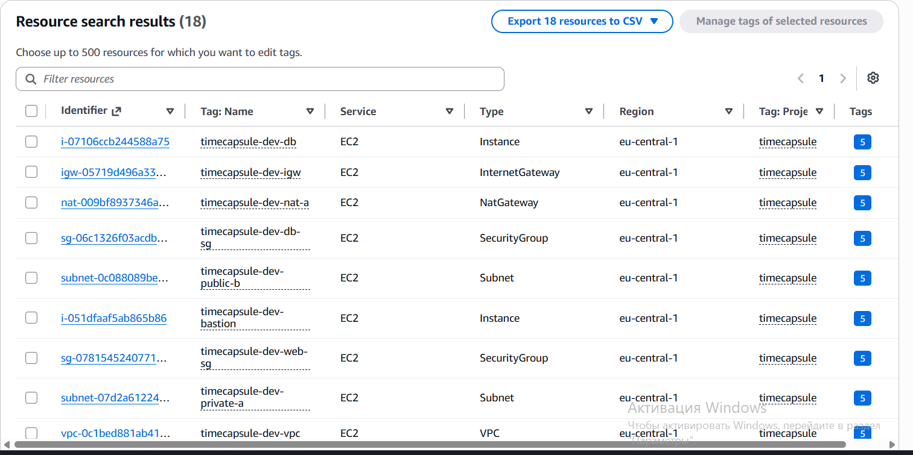](lab3/18-tag-editor.png)

*Рисунок 18 — Ресурсы с тегом `Project = timecapsule` в Tag Editor*

**Как по тегам найти все ресурсы, которые нужно удалить после окончания проекта? Зачем нужен тег Owner, если аккаунт у вас личный?**

В Tag Editor нужно искать ресурсы по тегу `Project = timecapsule` (можно ещё сузить по `Lab = lab3`), получить полный список и удалить их. Тег `Owner` показывает, кто отвечает за ресурс и кого спрашивать о нём. В личном аккаунте он пока не очень нужен, но если аккаунтом начнут пользоваться несколько человек или ресурсы будут разбирать по проектам и расходам, без него не понять, чьи они. К тому же это хорошая привычка для рабочих аккаунтов.

### Остановка экземпляров

Все экземпляры остановлены через Instance state → Stop instance.

[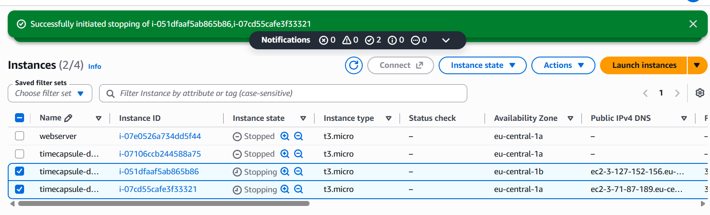](lab3/19-stop-instances.png)

*Рисунок 19 — Экземпляры остановлены (на рисунке виден момент остановки bastion и web-server, остальные уже в состоянии Stopped)*

---

## 10. Вывод

В ходе работы построена собственная сеть в AWS: VPC `10.9.0.0/16` с четырьмя подсетями в двух зонах доступности, Internet Gateway и две таблицы маршрутов. Сервер web-server размещён в публичной подсети, а база данных PostgreSQL на db-server в приватной подсети без публичного адреса. SSH на серверы настроен только через bastion. NAT Gateway создан временно для установки пакетов и сразу удалён вместе с маршрутом и Elastic IP. Я проверил, как Security Group и Network ACL ограничивают трафик, и убедился, что доступ к базе защищён несколькими независимыми уровнями. Ресурсы подписаны тегами по единому соглашению, а в конце экземпляры остановлены.

---

## 11. Список использованных источников

1. Методические материалы лабораторной работы №3, лекция 5 «Виртуальные сети в облаке. Amazon VPC» и Hands-on 5.1.
2. Документация AWS: Amazon VPC, EC2, Resource Groups & Tag Editor.
3. Документация PostgreSQL: `listen_addresses`, `pg_hba.conf`.
