# Лабораторная работа №4. Облачные хранилища. Amazon S3

## 1. Общая информация

**ФИО:** Codjebas Oleg
**Группа:** IA2403
**Специальность:** Informatică aplicată (IA)
**Выбранный уровень:** базовый
**AWS Region:** `eu-central-1 (Frankfurt)`

---

## 2. Цель работы

Научиться хранить файлы в объектном хранилище Amazon S3 и управлять ими: создавать бакет и объекты в консоли и из командной строки, защищать данные версионированием, ограничивать рост хранилища правилами жизненного цикла и управлять доступом с помощью политик и подписанных URL.

---

## 3. Задание 1. Бакет и объекты в консоли

Создан бакет `timecapsule-dev-uploads-cloud-student`: тип General purpose, ACLs disabled, включён Block all public access, версионирование на этом этапе выключено, шифрование SSE-S3, добавлены обязательные теги (`Lab = lab4`). В бакете созданы папки `uploads/` (картинка и PDF) и `backups/` (текстовый файл).

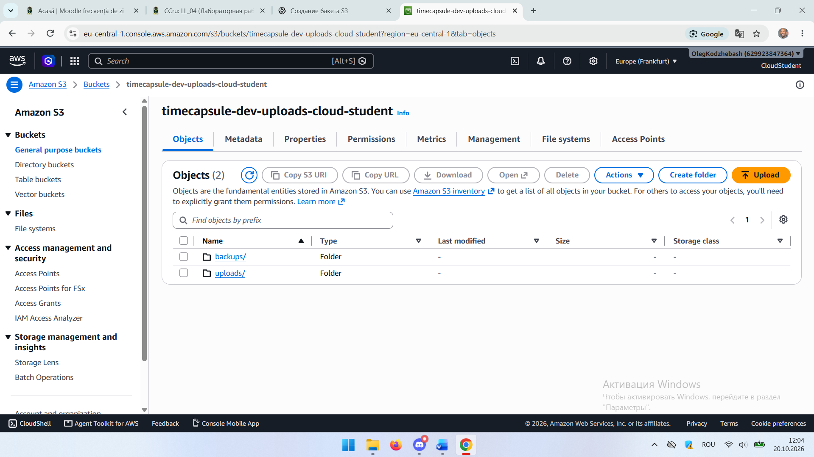

*Рисунок 1 — Корень бакета: папки `backups/` и `uploads/`*

Свойства картинки `localhost_5173_.png`:

| Свойство     | Значение                                                                                  |
| ------------ | ----------------------------------------------------------------------------------------- |
| Key          | `uploads/localhost_5173_.png`                                                             |
| Content-Type | `image/png`                                                                               |
| ETag         | `2b58ca4d924c4d7707e684d134c316c2`                                                        |
| Object URL   | `https://timecapsule-dev-uploads-cloud-student.s3.eu-central-1.amazonaws.com/uploads/localhost_5173_.png` |
| Размер       | 916,9 KB                                                                                  |

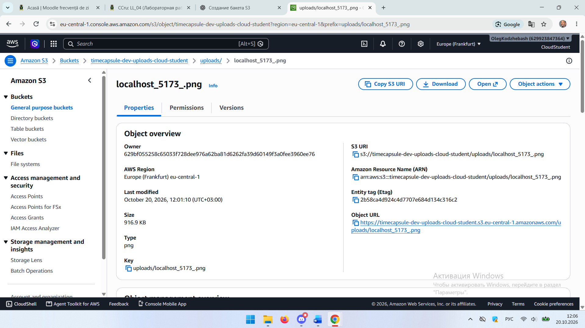

*Рисунок 2 — Object overview картинки: ключ, ETag, Object URL*

Object URL, открытый в браузере, возвращает ошибку `AccessDenied`:

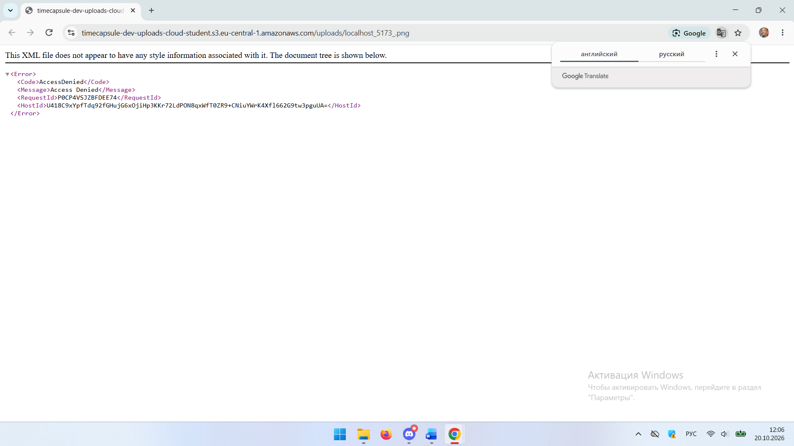

*Рисунок 3 — Ответ S3 на запрос Object URL без подписи: `AccessDenied`*

### Контрольные вопросы

**Какой ключ у картинки?**

Ключ картинки `uploads/localhost_5173_.png`. В S3 нет настоящих папок: «папка» `uploads/` — это просто часть ключа (префикс), а весь путь вместе с именем файла и есть имя объекта.

**Почему Object URL не открывается, хотя вы владелец бакета?**

Object URL — это обычный анонимный HTTP-запрос без подписи, S3 не знает, что его отправил владелец. Объект приватный, а Block Public Access запрещает публичный доступ, поэтому S3 отвечает `AccessDenied`. В консоли вы работаете со своими IAM-учётными данными, поэтому там объект доступен.

**Что на самом деле создала кнопка Create folder?**

Она создала пустой объект размером 0 байт с ключом, оканчивающимся на `/` (например, `uploads/`). Консоль показывает такой объект как папку. Это видно и в выводе `aws s3 ls --recursive` (рисунок 4): там есть строки `uploads/` и `backups/` с размером 0.

---

## 4. Задание 2. Объекты из командной строки

В CloudShell задана переменная `BUCKET=timecapsule-dev-uploads-cloud-student`, созданы файлы `photo.txt`, `2026/10/report.txt`, `2026/10/report-2.txt`. Затем выполнены загрузка и синхронизация:

```bash
aws s3 cp photo.txt s3://$BUCKET/uploads/photo.txt
aws s3 sync 2026 s3://$BUCKET/uploads/2026
```

Содержимое бакета тремя способами:

```bash
aws s3 ls s3://$BUCKET
aws s3 ls s3://$BUCKET/uploads/
aws s3 ls s3://$BUCKET --recursive
```

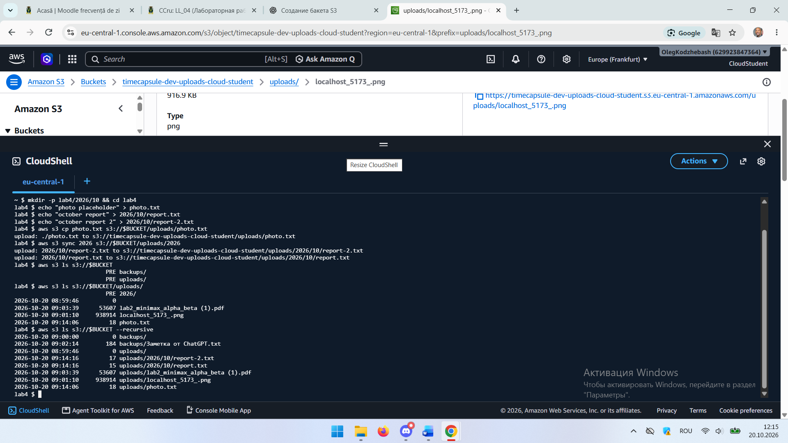

*Рисунок 4 — Вывод трёх команд `aws s3 ls`*

Метаданные картинки и файла `report.txt` без скачивания:

```bash
aws s3api head-object --bucket $BUCKET --key "uploads/localhost_5173_.png"
aws s3api head-object --bucket $BUCKET --key uploads/2026/10/report.txt
```

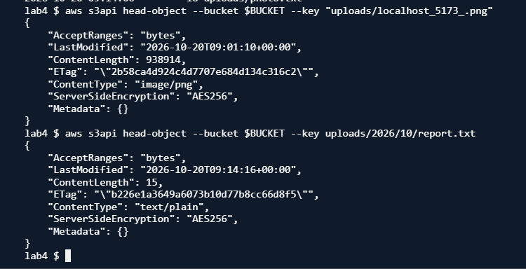

*Рисунок 5 — Вывод `head-object`: у картинки `image/png`, у `report.txt` `text/plain`*

Скачивание одного объекта и удаление другого:

```bash
aws s3 cp s3://$BUCKET/uploads/photo.txt downloaded.txt && cat downloaded.txt
aws s3 rm s3://$BUCKET/uploads/2026/10/report-2.txt
```

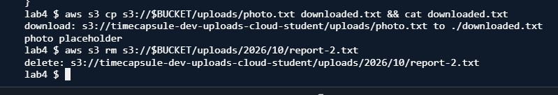

*Рисунок 6 — Скачивание `photo.txt` (содержимое `photo placeholder`) и удаление `report-2.txt`*

### Контрольные вопросы

**Почему первая команда `ls` показывает `PRE uploads/` и `PRE backups/`, а третья показывает полные ключи?**

Без флага `--recursive` CLI запрашивает список с разделителем `/` и группирует ключи по первому уровню: всё, что лежит глубже, сворачивается в префикс `PRE`. С `--recursive` разделитель не используется, и выводятся все объекты с полными ключами, включая пустые объекты-«папки».

**Какой Content-Type получил `report.txt`, хотя вы его не указывали?**

`text/plain`. AWS CLI определяет тип по расширению файла `.txt` и сам передаёт его в заголовке при загрузке. Для картинки браузерная консоль определила `image/png` по расширению `.png`.

---

## 5. Задание 3. Политика бакета: только HTTPS

В Permissions → Bucket policy добавлена политика, которая запрещает любые действия, если запрос пришёл не по HTTPS:

```json
{
  "Version": "2012-10-17",
  "Statement": [
    {
      "Sid": "DenyInsecureTransport",
      "Effect": "Deny",
      "Principal": "*",
      "Action": "s3:*",
      "Resource": [
        "arn:aws:s3:::timecapsule-dev-uploads-cloud-student",
        "arn:aws:s3:::timecapsule-dev-uploads-cloud-student/*"
      ],
      "Condition": {
        "Bool": { "aws:SecureTransport": "false" }
      }
    }
  ]
}
```

Проверка в CloudShell: первая команда работает по HTTPS и проходит, вторая принудительно идёт по `http://` и получает `AccessDenied`.

```bash
aws s3 ls s3://$BUCKET/uploads/
aws s3 ls s3://$BUCKET/uploads/ --endpoint-url http://s3.eu-central-1.amazonaws.com
```

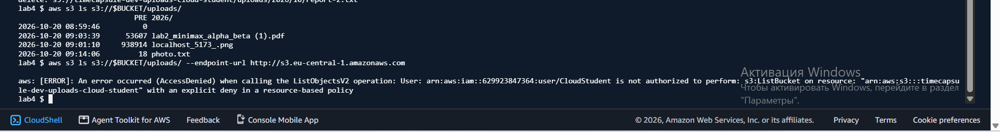

*Рисунок 7 — Запрос по HTTPS успешен, запрос по HTTP отклонён: `AccessDenied ... with an explicit deny in a resource-based policy`*

### Контрольные вопросы

**Почему вторая команда получает AccessDenied, хотя у вас права администратора?**

Политика `AdministratorAccess` только разрешает действия, а в политике бакета стоит явный запрет (`Deny`). Явный запрет всегда сильнее любого разрешения, поэтому запрос по HTTP отклоняется для всех, в том числе для администратора. Это видно в тексте ошибки: `explicit deny in a resource-based policy`.

**Почему Block Public Access не помешал сохранить политику с `"Principal": "*"`?**

Block Public Access блокирует политики, которые открывают доступ публично. Наша политика ничего не разрешает, а только запрещает, поэтому она не делает бакет публичным. Звёздочка в `Principal` здесь означает «запретить всем», что безопасно.

---

## 6. Задание 4. Версионирование и защита от удаления

Включено версионирование (Properties → Bucket Versioning → Enable). У файлов, загруженных до включения версионирования, идентификатор версии равен `null`. Затем создана история: файл `notes.txt` с текстом `v1` загружен в `uploads/`, после этого загружена вторая версия с текстом `v2`. Объект удалён при выключенном Show versions, после чего восстановлен и откачен к `v1`.

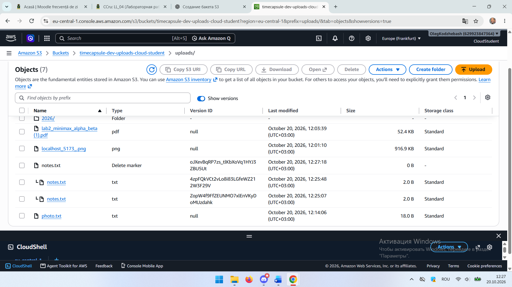

*Рисунок 8 — Show versions включён: маркер удаления (Delete marker) и две версии `notes.txt` (v2 в 12:25:48 и v1 в 12:25:07)*

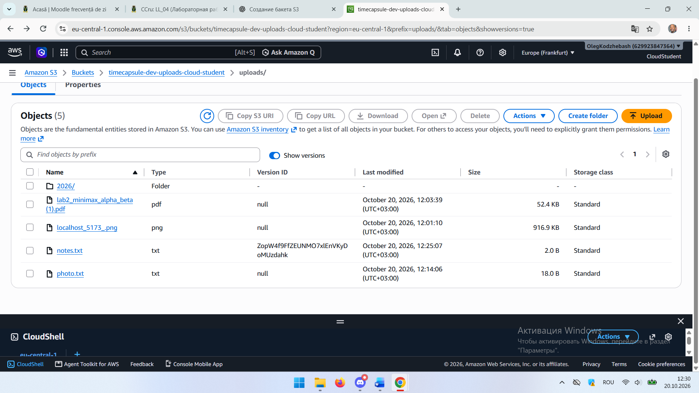

*Рисунок 9 — После удаления маркера и версии v2 осталась одна версия `notes.txt` (v1, загружена в 12:25:07), она стала текущей*

### Контрольный вопрос

**Чем удаление в шаге 3 отличается от удаления в шаге 5? Какое из них можно отменить? Какой способ защищает от случайного удаления, а какой нужно запрещать приложению?**

В шаге 3 при выключенном Show versions удаление не уничтожает данные: S3 лишь добавляет маркер удаления, и объект перестаёт отображаться. Это можно отменить, удалив маркер. В шаге 5 удаляется конкретная версия по её идентификатору, это окончательное удаление без возможности вернуть данные (консоль просит отдельного подтверждения). Случайное удаление защищено первым способом, он обратим. Постоянное удаление версий нужно запрещать приложению (право `s3:DeleteObjectVersion`), иначе можно потерять всю историю.

---

## 7. Задание 5. Правило жизненного цикла

В Management создано правило `timecapsule-dev-noncurrent`:

| Параметр                                | Значение                                           |
| --------------------------------------- | -------------------------------------------------- |
| Область действия                        | только префикс `uploads/` (`backups/` не затронут) |
| Переход неактуальных версий             | в `Standard-IA` через 30 дней                      |
| Удаление неактуальных версий            | через 90 дней, `Number of newer versions to retain` = 2 |
| Незавершённые загрузки частями          | удаляются через 7 дней                             |
| Действия с актуальными версиями         | не заданы                                          |

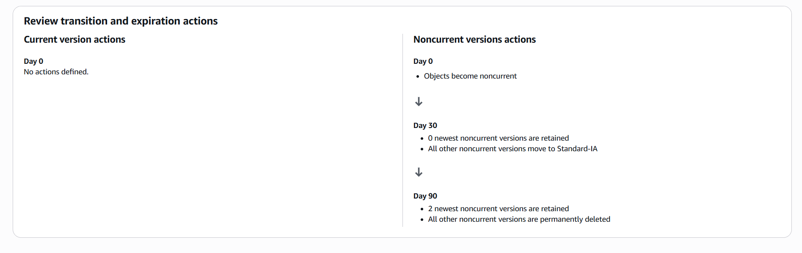

*Рисунок 10 — Review transition and expiration actions: на 30-й день неактуальные версии уходят в Standard-IA, на 90-й удаляются, кроме двух новейших*

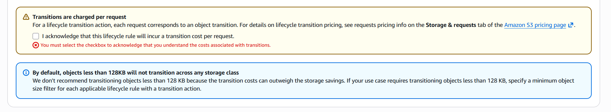

*Рисунок 11 — Предупреждение о плате за переходы (подтверждено галочкой) и сообщение о том, что объекты меньше 128 КБ по умолчанию не переходят в другие классы*

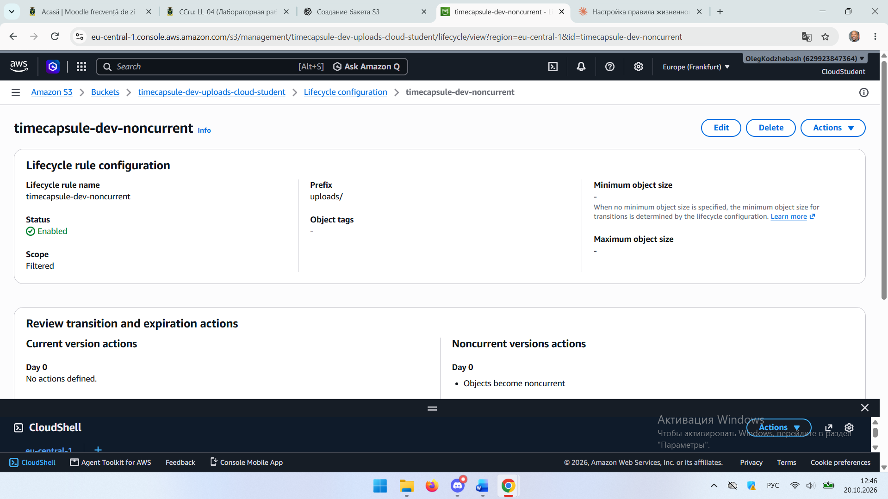

*Рисунок 12 — Правило создано: статус Enabled, область Filtered, префикс `uploads/`*

### Контрольные вопросы

**Как поведёт себя правило для файла, который перезаписывали 10 раз за неделю? Какие версии и когда окажутся в Standard-IA, какие будут удалены?**

Будет одна актуальная версия и 10 неактуальных. Срок для каждой неактуальной версии отсчитывается с момента, когда её заменила следующая, поэтому все десять примерно через 30 дней после замены перейдут в Standard-IA (в этом блоке ограничения «retain» нет). Через 90 дней после замены правило удалит все неактуальные версии, кроме двух самых новых, то есть 8 самых старых. Две новейшие неактуальные версии и актуальная версия останутся.

**Почему наши маленькие тестовые файлы в Standard-IA не попадут?**

Минимальный тарифицируемый размер объекта в Standard-IA составляет 128 КБ, и за меньший файл всё равно пришлось бы платить как за 128 КБ. Поэтому по умолчанию S3 не переводит объекты меньше 128 КБ в другие классы: плата за переход выше возможной экономии. Наши файлы по 2–18 байт остаются в Standard.

**Что такое незавершённая загрузка частями и почему за неё приходится платить?**

Большой файл загружается по частям: создаётся загрузка, отправляются части, затем загрузка завершается. Если последний шаг не выполнен (обрыв связи, ошибка), уже загруженные части остаются в бакете. Они не видны в списке объектов, но занимают место и тарифицируются как обычное хранилище. Правило с удалением через 7 дней автоматически очищает такие остатки.

---

## 8. Задание 6. Подписанные URL

1. В консоли (Object actions → Share with a presigned URL) создана ссылка на картинку со сроком 5 минут и открыта в приватном окне браузера.
2. В CloudShell создана ссылка на `uploads/photo.txt` сроком 2 минуты и открыта в приватном окне:

```bash
aws s3 presign s3://$BUCKET/uploads/photo.txt --expires-in 120
```

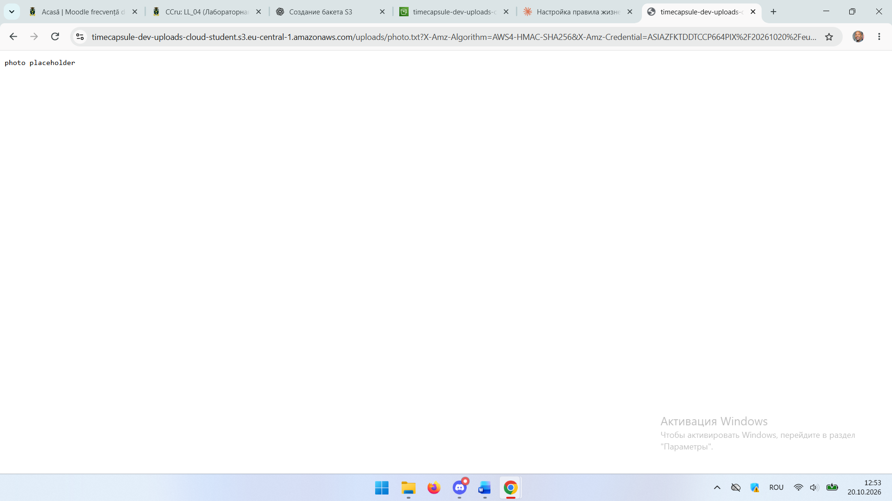

*Рисунок 13 — Ссылка из CLI открывает содержимое `photo.txt` (`photo placeholder`)*

3. В ссылке `photo.txt` заменён на `notes.txt`:

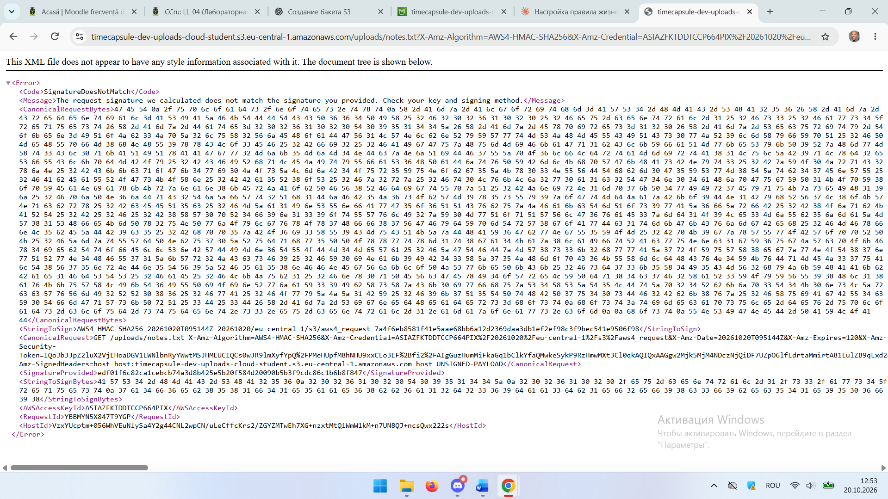

*Рисунок 14 — Ответ S3 на изменённую ссылку: `SignatureDoesNotMatch`*

4. После истечения 2 минут исходная ссылка открыта ещё раз:

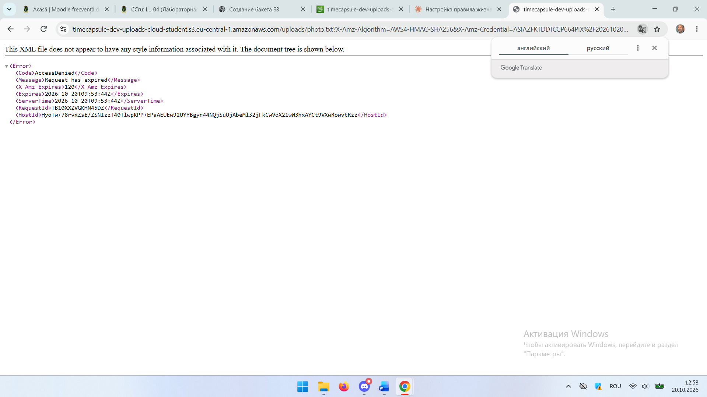

*Рисунок 15 — Ответ S3 на просроченную ссылку: `AccessDenied`, `Request has expired` (`X-Amz-Expires = 120`)*

После выполнения заданий Части 1 временные файлы удалены командой `cd ~ && rm -rf lab4`, проверка `ls ~/lab4` подтвердила, что папки больше нет. Бакет сохранён.

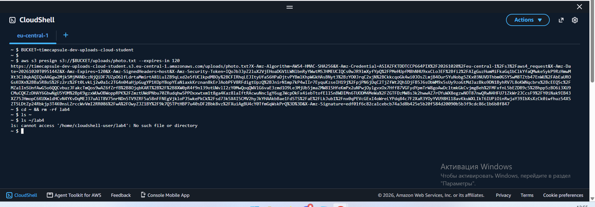

*Рисунок 16 — Команда `aws s3 presign` и очистка рабочей папки. Ссылка на рисунке уже истекла (срок 2 минуты)*

### Контрольные вопросы

**Какие ошибки вернул S3 в шагах 3 и 4?**

В шаге 3 вернулась ошибка `SignatureDoesNotMatch` (HTTP 403): подпись не подходит к изменённому запросу. В шаге 4 вернулась `AccessDenied` с сообщением `Request has expired` (HTTP 403): срок действия ссылки закончился.

**Почему нельзя получить другой файл, просто поменяв ключ в ссылке?**

Подпись `X-Amz-Signature` вычисляется из параметров запроса, в том числе из пути с ключом объекта, секретным ключом пользователя. При смене `photo.txt` на `notes.txt` S3 заново считает подпись для пришедшего запроса, и она не совпадает с подписью в ссылке. Подделать правильную подпись без секретного ключа нельзя, поэтому ссылка даёт доступ только к одному объекту и на ограниченное время.

**Обращалась ли команда `aws s3 presign` к S3, когда создавала ссылку?**

Нет. Команда работает локально: берёт ваши учётные данные и подписывает запрос, не отправляя его в сеть. S3 узнаёт о ссылке только тогда, когда по ней переходят. Поэтому ссылка создаётся мгновенно и даже для несуществующего объекта.

---

## 9. Вывод

В ходе работы создан приватный бакет S3 с шифрованием SSE-S3, загружены и просмотрены объекты через консоль и AWS CLI. Добавлена политика бакета, запрещающая запросы без HTTPS. Включено версионирование, на практике проверены маркер удаления и откат к старой версии. Настроено правило жизненного цикла для неактуальных версий и незавершённых загрузок частями, а также проверена работа подписанных URL: подмена ключа и истечение срока приводят к ошибкам.

---

## 10. Список использованных источников

1. Методические материалы лабораторной работы №4.
2. Документация AWS: Amazon S3 (Versioning, Lifecycle, Presigned URLs, Bucket policies), AWS CLI.
