# Лабораторная работа №5. Облачные базы данных. Amazon RDS

## 1. Общая информация

**ФИО:** Codjebas Oleg
**Группа:** IA2403
**Специальность:** Informatică aplicată (IA)
**Выбранный уровень:** базовый
**AWS Region:** `eu-central-1 (Frankfurt)`

---

## 2. Цель работы

Научиться размещать базу данных в Amazon RDS с ограниченным сетевым доступом, работать с репликой для чтения и восстанавливать данные после ошибки.

---

## 3. Задание 1. Размещение и доступ к базе

Все ресурсы учебные: префикс `lab5-`, тег `Lab = lab5`, VPC из ЛР3.

1. Создана группа подсетей `lab5-db-subnets` с приватными подсетями `private-a` и `private-b`.
2. Создана Security Group веб-сервера `lab5-web-sg` (`sg-09f17d40bc1a72fc6`). Входящее правило: SSH (TCP 22).
3. Создана Security Group базы `lab5-rds-sg` (`sg-0ff11fe507f122ac5`). Входящее правило: TCP **5432**, источник - Security Group `lab5-web-sg`. Исходящее правило оставлено по умолчанию (`0.0.0.0/0`).

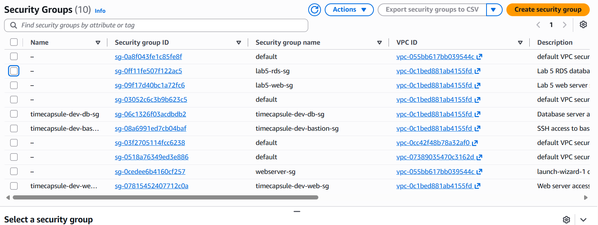

*Рисунок 1 - Созданные группы `lab5-rds-sg` и `lab5-web-sg` в VPC лабораторной работы*

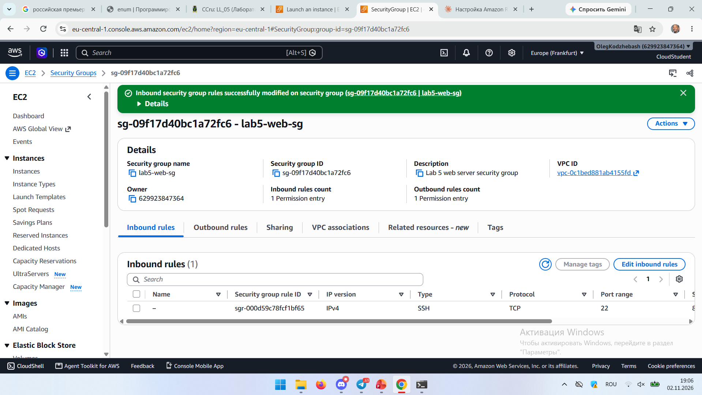

*Рисунок 2 - `lab5-web-sg`: правила успешно изменены, входящее правило SSH (22)*

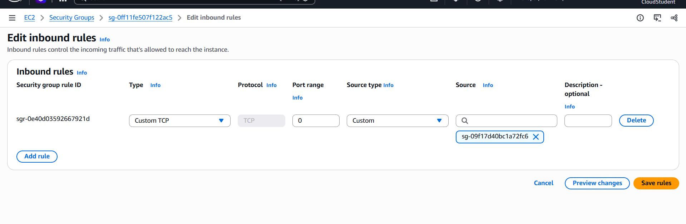

*Рисунок 3 - Входящие правила `lab5-rds-sg`: источник - Security Group `sg-09f17d40bc1a72fc6` (`lab5-web-sg`), а не IP-адрес*

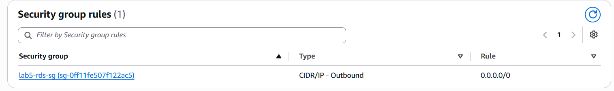

*Рисунок 4 - Исходящее правило `lab5-rds-sg` (`0.0.0.0/0`)*

### Контрольные вопросы

**Почему для ограничения доступа удобнее использовать Security Group источника, а не его IP-адрес?**

IP-адрес сервера может измениться (пересоздание экземпляра, замена на новый сервер), и правило придётся править вручную. Правило со ссылкой на Security Group действует для всех экземпляров, которым эта группа назначена: новые серверы получают доступ автоматически, а посторонние машины, не входящие в группу, доступа не получают.

**Зачем указывать две подсети, если учебная база будет работать в одной зоне?**

RDS требует, чтобы группа подсетей покрывала минимум две зоны доступности. Это нужно, чтобы базу или её копию можно было разместить в другой зоне: для реплики (задание 4), для резервного экземпляра Multi-AZ и для переноса экземпляра при сбое. В этой работе реплика создаётся во второй зоне (`eu-central-1b`), поэтому вторая подсеть обязательна.

---

## 4. Задание 2. База RDS

Создана база `lab5-db` со следующими параметрами:

| Параметр | Значение |
|---|---|
| Движок | PostgreSQL 18.3 |
| Шаблон | Sandbox |
| Класс экземпляра | `db.t4g.micro` |
| Хранилище | gp3, 20 ГиБ, автоувеличение выключено |
| Пользователь | `dbadmin` |
| Группа подсетей | `lab5-db-subnets` |
| Зона доступности | `eu-central-1a` |
| Публичный доступ | нет (Not publicly accessible) |
| Security Group | `lab5-rds-sg` |
| Имя базы внутри экземпляра | `lab5` |
| Хранение резервных копий | 7 дней |
| Шифрование (KMS) | включено |
| Deletion protection | включена |

База перешла в состояние Available. Версия PostgreSQL и параметры подключения подтверждены на рисунке 6.

### Контрольные вопросы

**Как убедиться, что база принимает подключения только с нужного сервера?**

1. С веб-сервера порт доступен: `nc -zv -w 5 <endpoint> 5432` выдаёт `Connected` (рисунок 5).
2. У базы нет публичного адреса: с моего компьютера endpoint разрешается только в приватный адрес `10.9.10.43` (рисунок 7), который из интернета недоступен.
3. Во входящем правиле `lab5-rds-sg` единственный источник - `lab5-web-sg` (рисунок 3).

Пока правило было настроено неверно (в окне редактирования на рисунке 3 порт был `0`), проверка `nc` завершилась `TIMEOUT`. После исправления порта на 5432 соединение установилось. Это показывает, что доступом управляет именно Security Group.

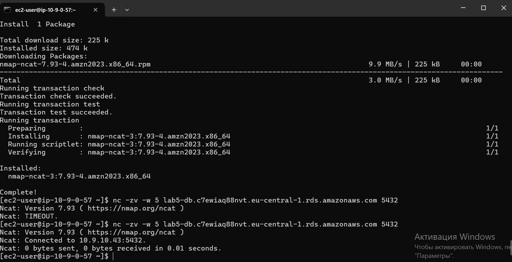

*Рисунок 5 - Установка `nmap-ncat` и проверка порта 5432: первая попытка `TIMEOUT`, вторая `Connected to 10.9.10.43:5432`*

**Почему для неё выбрана зона eu-central-1a?**

Веб-сервер находится в подсети зоны `a` (адрес `10.9.0.57`), поэтому база в той же зоне не создаёт платного межзонального трафика и не добавляет задержки. Кроме того, реплика в задании 4 должна быть в другой зоне (`eu-central-1b`).

**От чего защищает deletion protection, а от чего нет?**

Защищает от случайного удаления самого экземпляра через консоль, CLI или API: пока опция включена, удалить базу нельзя. Не защищает от потери данных внутри базы: `DELETE`, `DROP TABLE` и ошибочные запросы выполняются как обычно (в задании 5 данные удалены именно так). Не защищает от сбоев оборудования и неверных изменений данных. Для этих случаев нужны резервные копии и реплики.

---

## 5. Задание 3. Подключение к базе

Создан веб-сервер (EC2) с группой `lab5-web-sg`. Подключение к нему выполнено по SSH, затем `psql -h <endpoint> -U dbadmin -d lab5`. CloudShell не использовался.

Выполнены `SELECT version();` и `\conninfo`, создана таблица `notes` и добавлены три строки.

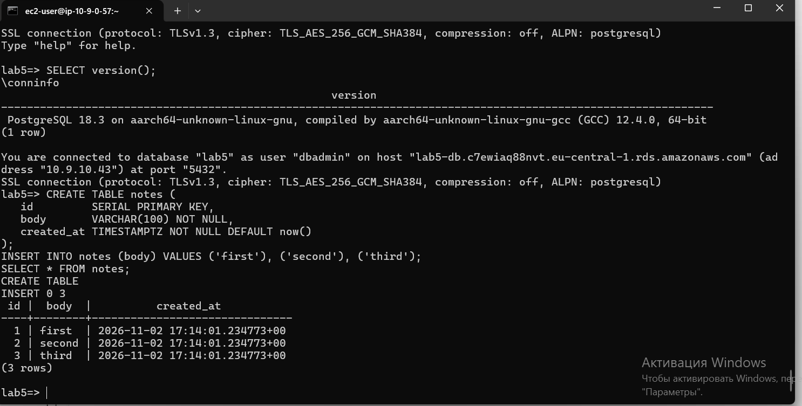

*Рисунок 6 - `SELECT version()` (PostgreSQL 18.3), `\conninfo` (база `lab5`, пользователь `dbadmin`, хост `lab5-db.c7ewiaq88nvt.eu-central-1.rds.amazonaws.com`, адрес `10.9.10.43`, порт 5432, TLSv1.3), создание таблицы и `SELECT * FROM notes` (3 строки)*

IP-адрес базы: на сервере приложения `\conninfo` показывает `10.9.10.43`, на моём компьютере `nslookup` возвращает тот же адрес.

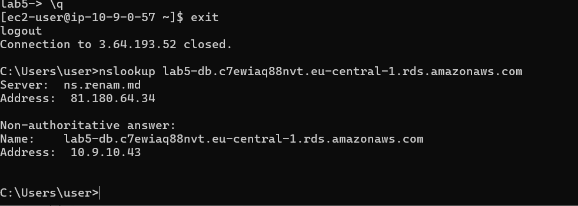

*Рисунок 7 - `nslookup lab5-db.c7ewiaq88nvt.eu-central-1.rds.amazonaws.com` на моём компьютере: адрес `10.9.10.43`*

Endpoint разрешается в приватный адрес из диапазона VPC (`10.9.0.0/16`). Публичного адреса у базы нет, поэтому с компьютера напрямую подключиться к ней нельзя.

---

## 6. Задание 4. Реплика для чтения

Создана реплика `lab5-db-replica` для `lab5-db`: класс `db.t4g.micro`, зона `eu-central-1b`, без публичного доступа, группа `lab5-rds-sg`, защита от удаления выключена.

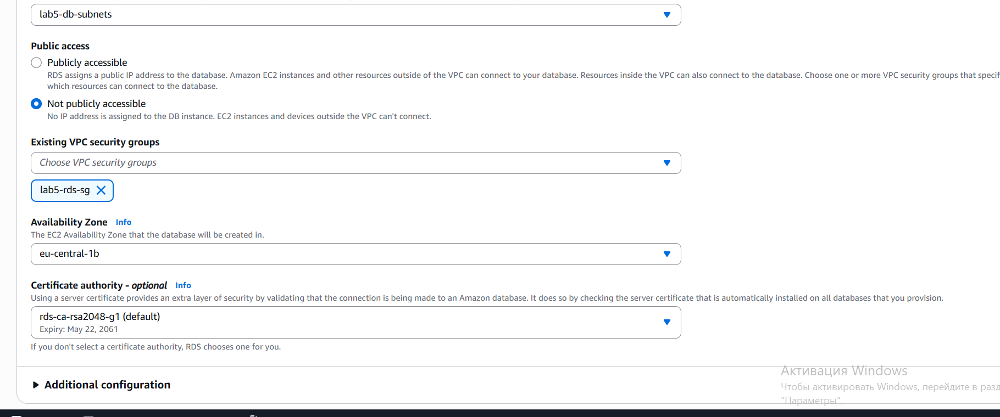

*Рисунок 8 - Параметры реплики: Not publicly accessible, `lab5-rds-sg`, зона `eu-central-1b`*

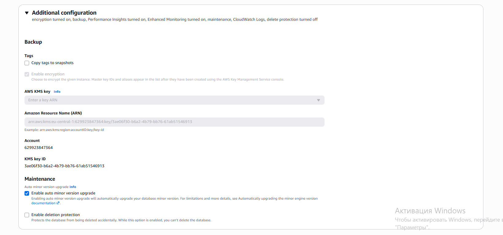

*Рисунок 9 - Additional configuration реплики: Enable deletion protection выключено*

На реплике (подключение по её endpoint) выполнены `pg_is_in_recovery()`, `SELECT * FROM notes` и `INSERT`:

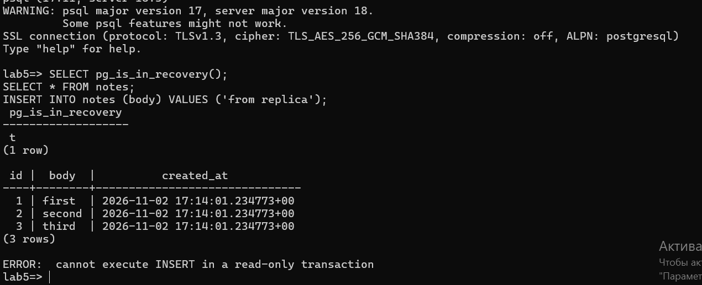

*Рисунок 10 - На реплике `pg_is_in_recovery()` возвращает `t`, `SELECT` показывает три строки, `INSERT` завершается ошибкой `cannot execute INSERT in a read-only transaction`*

На основной базе `pg_is_in_recovery()` возвращает `f`, строка `fourth` добавлена (`INSERT 0 1`):

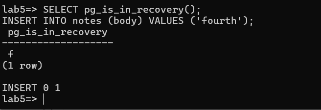

*Рисунок 11 - Основная база: `pg_is_in_recovery()` = `f`, добавлена строка `fourth`*

На реплике строка `fourth` появилась (время вставки 17:46:48 UTC):

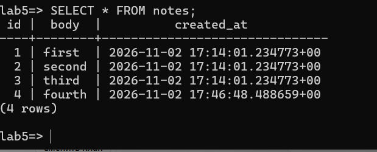

*Рисунок 12 - Чтение таблицы `notes` на реплике: 4 строки, включая `fourth`*

Вкладка Monitoring основной базы:

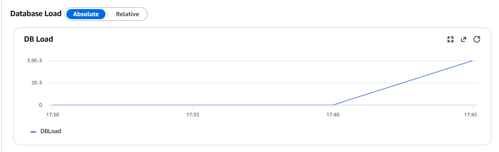

*Рисунок 13 - Вкладка Monitoring (график DB Load). Метрика `ReplicaLag`: ВСТАВИТЬ СКРИНШОТ*

### Контрольные вопросы

**Почему INSERT на реплике не выполнился?**

Реплика находится в режиме восстановления (`pg_is_in_recovery() = t`): она только применяет журнал изменений, полученный от основной базы, и сама принимать записи не может. Любая запись отклоняется с ошибкой `read-only transaction`. На основной базе `pg_is_in_recovery()` равно `f`, и запись разрешена.

**Чем реплика для чтения отличается от резервного экземпляра Multi-AZ?**

Реплика для чтения получает изменения асинхронно, отвечает на запросы чтения через собственный endpoint и нужна для разгрузки основной базы. Она отстаёт на небольшое время (`ReplicaLag`) и при отказе основной базы автоматически её не заменяет. Резервный экземпляр Multi-AZ обновляется синхронно, запросов не принимает и нужен только для отказоустойчивости: при сбое RDS автоматически переключается на него, endpoint остаётся прежним.

---

## 7. Задание 5. Восстановление после ошибки

1. На основной базе запомнено время: `SELECT now() AT TIME ZONE 'UTC';` вернул **2026-11-02 17:51:01 UTC**.

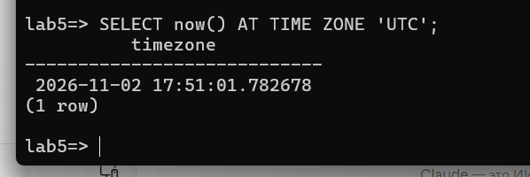

*Рисунок 14 - Время перед удалением: `2026-11-02 17:51:01.782678` (UTC)*

2. Примерно через минуту выполнен `DELETE FROM notes;`. Удалено 4 строки, таблица пуста.

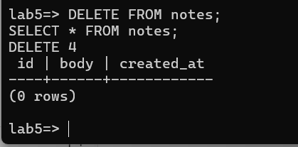

*Рисунок 15 - `DELETE 4` и пустая таблица на основной базе*

3. На реплике таблица тоже пуста.

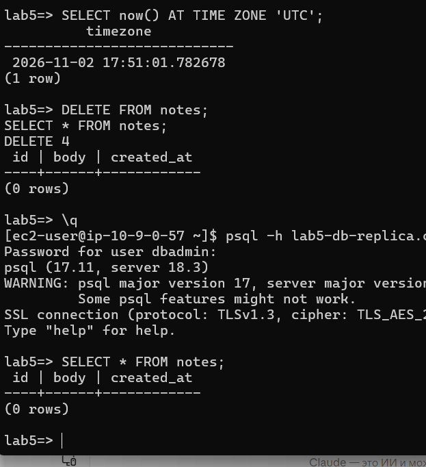

*Рисунок 16 - Реплика после удаления: `SELECT * FROM notes` возвращает 0 строк*

4. Реплика `lab5-db-replica` удалена (финальные снимки для реплик недоступны).

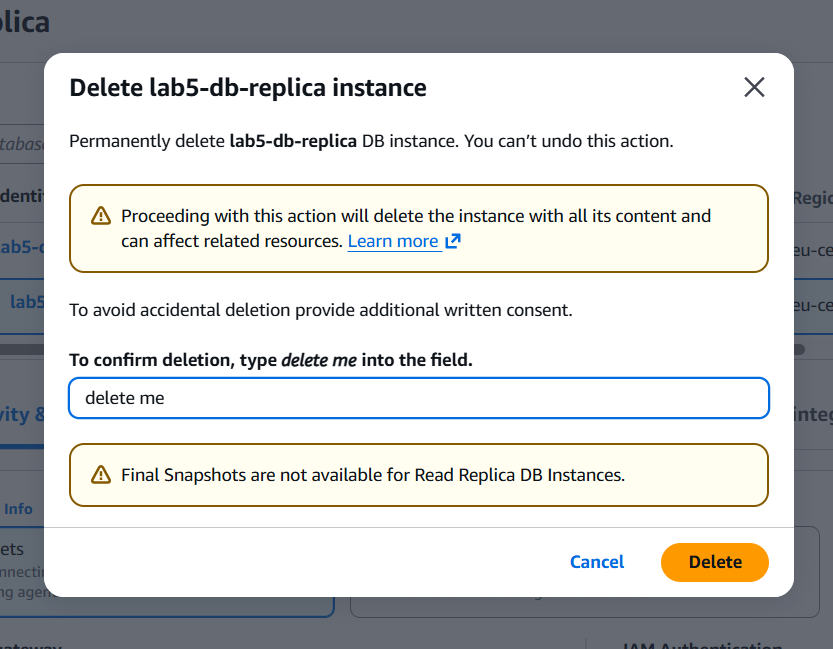

*Рисунок 17 - Подтверждение удаления `lab5-db-replica`*

5. На вкладке Maintenance & backups проверено, что Latest restore time позднее времени из шага 1. Скриншот: ВСТАВИТЬ СКРИНШОТ

6. Выполнен Restore to point in time на момент **2026-11-02 17:51:01 UTC** с учётом часового пояса, указанного рядом с полем времени. Параметры копии: имя `lab5-db-restore`, одна зона, `db.t4g.micro`, группа подсетей `lab5-db-subnets`, без публичного доступа, `lab5-rds-sg`, без защиты от удаления. Скриншот формы: ВСТАВИТЬ СКРИНШОТ

7. Когда копия стала Available, к ней подключились с веб-сервера. Таблица содержит все 4 строки, включая `fourth`. Первая попытка подключения закончилась ошибкой аутентификации, со второй попытки вход выполнен.

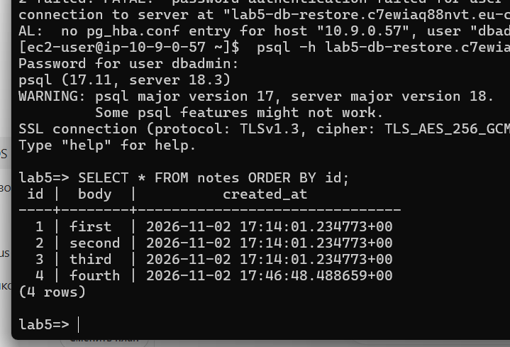

*Рисунок 18 - `SELECT * FROM notes ORDER BY id` на `lab5-db-restore`: строки `first`, `second`, `third`, `fourth` возвращены*

8. Копия удалена без финального снимка и без сохранения резервных копий.

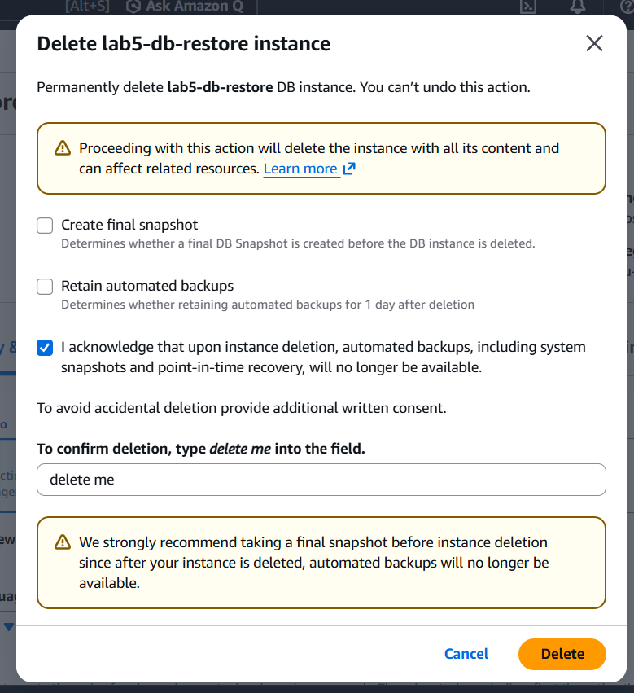

*Рисунок 19 - Удаление `lab5-db-restore`: Create final snapshot и Retain automated backups не выбраны*

### Контрольные вопросы

**Почему реплика не спасла данные?**

Реплика не является резервной копией: она повторяет все изменения основной базы, в том числе ошибочные. Команда `DELETE FROM notes;` дошла до реплики, и там тоже стало 0 строк (рисунок 16). От потери данных защищают только копии, сделанные до ошибки: автоматические резервные копии с журналом изменений.

**Почему восстановление создаёт новую базу, а не откатывает старую?**

Point-in-time restore собирает из снимка и журнала изменений отдельный экземпляр с новым endpoint. Старая база не затрагивается: можно сравнить данные и перенести только нужные строки, не потеряв то, что появилось после выбранного момента. Откат на месте уничтожил бы все записи после этого момента и сделал бы ошибку необратимой.

---

## 8. Завершение Части 1

Учебные ресурсы удалены:

1. У `lab5-db` выключена защита от удаления.
2. `lab5-db` удалена без финального снимка и без сохранения резервных копий.

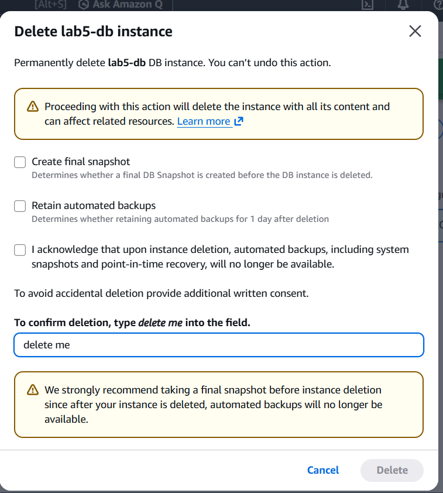

*Рисунок 20 - Окно удаления `lab5-db`: подтверждение вводом `delete me`, кнопка Delete станет активной после отметки подтверждения*

3. Удалены группа подсетей `lab5-db-subnets` и Security Group `lab5-rds-sg`.
4. Проверено, что реплики и копии не осталось.

---

## 9. Вывод

В ходе работы создана база RDS for PostgreSQL в приватной подсети, доступная только с веб-сервера через правило Security Group. Проверено подключение через `psql`, создана таблица `notes`. Создана реплика для чтения: она отвечает на запросы чтения, отклоняет запись и получает изменения основной базы. Смоделирована случайная потеря данных: реплика повторила удаление, а данные удалось вернуть только восстановлением на момент времени из автоматических резервных копий. Учебные ресурсы удалены, чтобы не тратить деньги.

---

## 10. Список использованных источников

1. Методические материалы лабораторной работы №5.
2. Документация AWS: Amazon RDS (Read replicas, Point-in-time recovery, Security groups, Deletion protection).
