# Лабораторная работа №6. Масштабирование и балансировка нагрузки. Elastic Load Balancing, Amazon EC2 Auto Scaling

## 1. Общая информация

**ФИО:** Codjebas Oleg **Группа:** IA2403 **Специальность:** Informatică aplicată (IA) **Выбранный уровень:** базовый (Часть 1, задания 1-3) **AWS Region:** `eu-central-1 (Frankfurt)`

**VPC:** `timecapsule-dev-vpc` (`vpc-0c1bed881ab4155fd`, `10.9.0.0/16`) из ЛР3. **Owner:** `CloudStudent`.

Все ресурсы части 1 названы с префиксом `lab6-` и имеют тег `Lab = lab6`.

---

## 2. Цель работы

Научиться распределять запросы между серверами с помощью Application Load Balancer и поручать Amazon EC2 Auto Scaling добавлять и убирать серверы в зависимости от нагрузки.

---

## 3. Что построено

| Ресурс | Имя | Основные параметры |
| --- | --- | --- |
| Целевая группа | `lab6-tg` | тип целей Instances, HTTP: 80, проверка работоспособности `GET /health` каждые 10 секунд |
| Балансировщик | `lab6-alb` | Application Load Balancer, Internet-facing, подсети `public-a` и `public-b`, listener HTTP:80 → `lab6-tg` |
| Шаблон запуска | `lab6-lt` | Amazon Linux 2023, `t3.micro`, пара ключей `Codjebas-keypair`, без подсети, User data с установкой nginx |
| Группа Auto Scaling | `lab6-asg` | подсети `public-a` и `public-b`, цели `lab6-tg`, ELB health checks, желаемое 2 / минимум 2 / максимум 4 |
| Политика масштабирования | `lab6-request-tracking` | Target tracking, метрика *Application Load Balancer request count per target*, целевое значение 50 |

Правила доступа:

- балансировщик принимает HTTP (80) из любого места (`0.0.0.0/0`);
- серверы принимают HTTP (80) только от группы безопасности балансировщика;
- SSH (22) на серверы разрешён только с bastion (`timecapsule-dev-bastion-sg`).

DNS-имя балансировщика: `lab6-alb-177844339.eu-central-1.elb.amazonaws.com`.

---

## 4. Задание 1. Балансировщик

Создана целевая группа `lab6-tg` в VPC из ЛР3: тип целей Instances, протокол HTTP, порт 80. Проверка работоспособности обращается по пути `/health` каждые 10 секунд. Затем создан `lab6-alb` со схемой Internet-facing в подсетях `public-a` и `public-b`. Listener принимает HTTP на порту 80 и передаёт запросы в `lab6-tg`.

Сразу после создания, пока в целевой группе не было серверов, адрес из поля DNS name открыт в браузере. Балансировщик вернул страницу **503 Service Temporarily Unavailable** (эта вкладка видна среди открытых вкладок браузера на рисунках 4 и 5).

### Контрольные вопросы

**Какой ответ вернул балансировщик и почему?**

Ответ `503 Service Temporarily Unavailable`. Сам балансировщик работает и принял запрос, но в целевой группе `lab6-tg` не было ни одной цели, а значит, ни одного исправного сервера, которому можно передать запрос. Серверы ещё не запущены: их создаёт группа Auto Scaling в задании 2. Когда исправных целей нет, ALB отвечает кодом 503.

**Зачем балансировщику подсети в двух зонах?**

Во-первых, ALB обязан работать минимум в двух подсетях из разных зон доступности, иначе AWS его не создаст. Во-вторых, в каждой выбранной зоне ALB размещает свой узел (с публичным адресом), и DNS-имя балансировщика указывает на узлы обеих зон. Если одна зона станет недоступна, запросы продолжат приходить через узел другой зоны и пойдут на серверы, которые там работают. Так отказ одной зоны не останавливает сервис.

---

## 5. Задание 2. Группа Auto Scaling

### Шаблон запуска

Создан шаблон `lab6-lt` для Amazon Linux 2023, тип `t3.micro`, пара ключей `Codjebas-keypair`. Подсеть в шаблоне не указана. Группа безопасности серверов пропускает HTTP только от балансировщика, SSH только от bastion. В User data передан скрипт:

```bash
#!/bin/bash
dnf install -y nginx
TOKEN=$(curl -s -X PUT "http://169.254.169.254/latest/api/token" -H "X-aws-ec2-metadata-token-ttl-seconds: 300")
AZ=$(curl -s -H "X-aws-ec2-metadata-token: $TOKEN" http://169.254.169.254/latest/meta-data/placement/availability-zone)
echo "<h1>$(hostname)</h1><p>Zone: $AZ</p>" > /usr/share/nginx/html/index.html
echo "OK" > /usr/share/nginx/html/health
systemctl enable --now nginx
```

Скрипт устанавливает nginx, берёт из метаданных экземпляра (через токен IMDSv2) зону доступности, записывает на главную страницу имя сервера и зону, а в файл `/health` пишет `OK`: по этому пути балансировщик проверяет работоспособность.

### Группа и политика

Создана группа `lab6-asg` из шаблона `lab6-lt` в подсетях `public-a` и `public-b`, подключённая к целевой группе `lab6-tg`. Включены проверки ELB (Elastic Load Balancing health checks), поэтому группа заменяет серверы, не прошедшие проверку балансировщика. Размер группы: желаемое 2, минимум 2, максимум 4. Добавлена политика target tracking `lab6-request-tracking` по метрике *Application Load Balancer request count per target* со значением 50.

По истории активности группа создана в 18:53:12 UTC, и в 18:54:17 UTC запущены два сервера (желаемая ёмкость изменилась с 0 до 2, рисунок 13).

Запущенные группой серверы (без имени, потому что имя им не задавалось) видны в списке EC2 в состоянии Running, проверки 3/3 пройдены, один в зоне `eu-central-1b`, второй в `eu-central-1a`.

[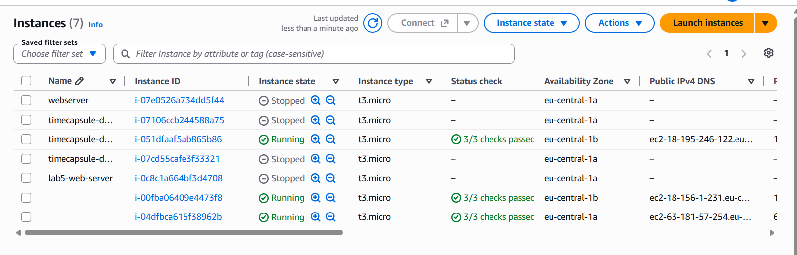](lab6/01-ec2-instances-asg.png)

*Рисунок 1 — Экземпляры `i-00fba06409e4473f8` (`eu-central-1b`) и `i-04dfbca615f38962b` (`eu-central-1a`), запущенные группой `lab6-asg`, в состоянии Running*

[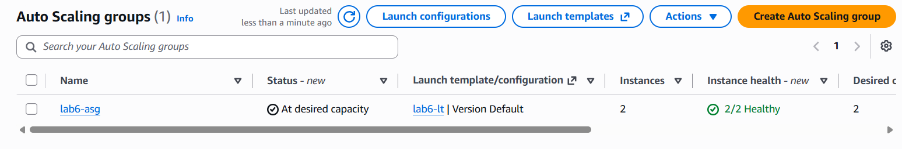](lab6/02-asg-2of2.png)

*Рисунок 2 — Группа `lab6-asg`: статус At desired capacity, 2 экземпляра, 2/2 Healthy, желаемое количество 2*

### Цели в состоянии healthy

После запуска обе цели в `lab6-tg` перешли в состояние `healthy`.

[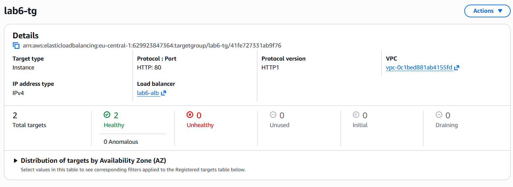](lab6/03-tg-2-healthy.png)

*Рисунок 3 — Целевая группа `lab6-tg`: Total targets 2, Healthy 2, Unhealthy 0 (тип целей Instance, HTTP: 80, балансировщик `lab6-alb`)*

### Ответы двух разных серверов

Адрес балансировщика обновлялся несколько раз. Ответили два разных сервера: сначала `ip-10-9-0-154` из зоны `eu-central-1a` (подсеть `public-a`, `10.9.0.0/24`), затем `ip-10-9-1-251` из зоны `eu-central-1b` (подсеть `public-b`, `10.9.1.0/24`).

[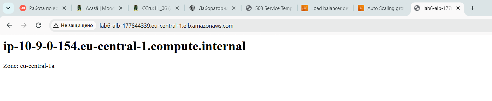](lab6/04-server-1a.png)

*Рисунок 4 — Ответ сервера `ip-10-9-0-154.eu-central-1.compute.internal`, зона `eu-central-1a`*

[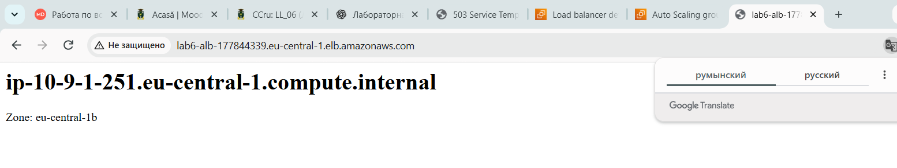](lab6/05-server-1b.png)

*Рисунок 5 — Ответ сервера `ip-10-9-1-251.eu-central-1.compute.internal`, зона `eu-central-1b`*

Дополнительно запрос к балансировщику выполнен из PowerShell командой `Invoke-WebRequest -Uri "http://$ALB/" -UseBasicParsing`. Ответ: код 200 OK, тело `<h1>ip-10-9-0-154.eu-central-1.compute.internal</h1><p>Zone: eu-central-1a</p>`.

[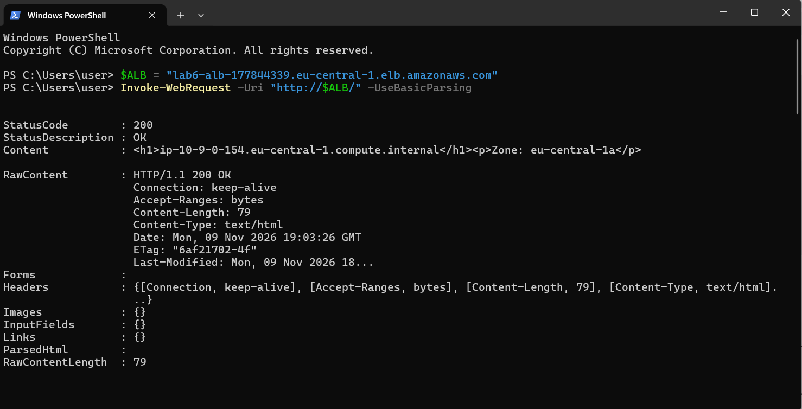](lab6/06-powershell-check.png)

*Рисунок 6 — Запрос к балансировщику из PowerShell: StatusCode 200, содержимое страницы сервера из зоны `eu-central-1a`*

### Контрольные вопросы

**Чем группа Auto Scaling отличается от целевой группы?**

Это два разных объекта с разными задачами. Целевая группа (`lab6-tg`) относится к балансировщику: это список серверов, которым ALB передаёт запросы, и правила проверки их работоспособности (`/health` каждые 10 секунд). Она сама ничего не запускает и не удаляет. Группа Auto Scaling (`lab6-asg`) управляет самими серверами: по шаблону запуска создаёт их, следит, чтобы их было нужное число, заменяет сломавшиеся и добавляет или убирает по нагрузке. Связывает их регистрация: новый сервер группа сама добавляет в `lab6-tg`, а удалённый убирает.

**Почему в шаблоне нет подсети?**

Шаблон описывает, *какой* сервер запускать (образ, тип, ключ, группы безопасности, User data), и он один для всех серверов. Подсеть привязана к конкретной зоне доступности, поэтому её выбирает группа: она распределяет серверы по `public-a` и `public-b`, чтобы они были в двух зонах, и при необходимости выравнивает их число между зонами. Если бы подсеть была записана в шаблон, все серверы оказались бы в одной зоне.

---

## 6. Задание 3. Нагрузка

### Запуск нагрузки

Нагрузка создавалась с локального компьютера (Windows) из PowerShell: в цикле отправлялись запросы на адрес балансировщика и считались успешные ответы (вместо `curl`-скрипта из задания использован эквивалент на PowerShell). Тест завершился на 9450 успешных запросах.

[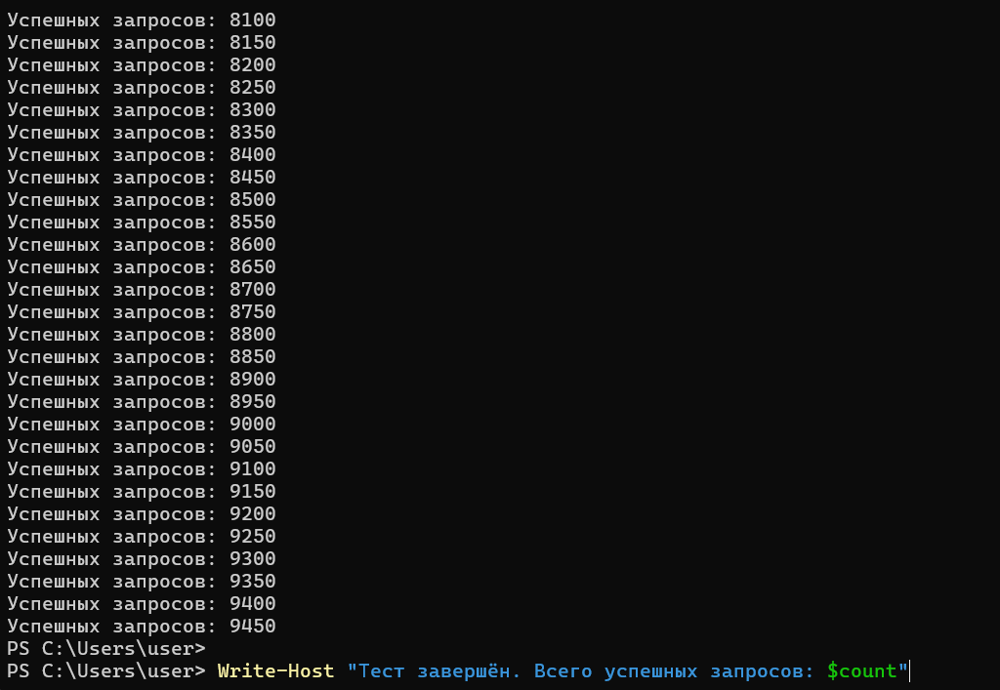](lab6/07-load-script.png)

*Рисунок 7 — Нагрузка на балансировщик: счётчик успешных запросов дошёл до 9450, тест завершён*

### Тревоги и график метрики

В CloudWatch → Alarms политика создала две тревоги: `TargetTracking-lab6-asg-AlarmHigh-82e2d984-e93d-4559-9dfa-61ec33477ea0` (добавляет серверы) и `TargetTracking-lab6-asg-AlarmLow-4b2d95fe-6ba3-4ae3-b183-2d86c552401b` (убирает лишние). В 19:26:44 UTC `AlarmHigh` перешла в состояние In alarm.

[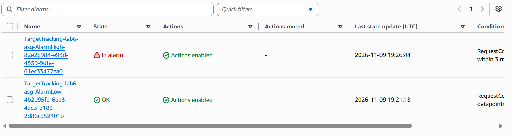](lab6/08-alarms-high-in-alarm.png)

*Рисунок 8 — Список тревог: `AlarmHigh` In alarm (последнее изменение 2026-11-09 19:26:44 UTC), `AlarmLow` OK*

График метрики `RequestCountPerTarget` для тревоги `AlarmHigh`: условие `RequestCountPerTarget > 50 for 3 datapoints within 3 minutes`. Во время нагрузки метрика достигала примерно 540 запросов на сервер, то есть в десять раз выше целевых 50. После запуска новых серверов значение упало примерно вдвое, а после окончания нагрузки до нуля.

[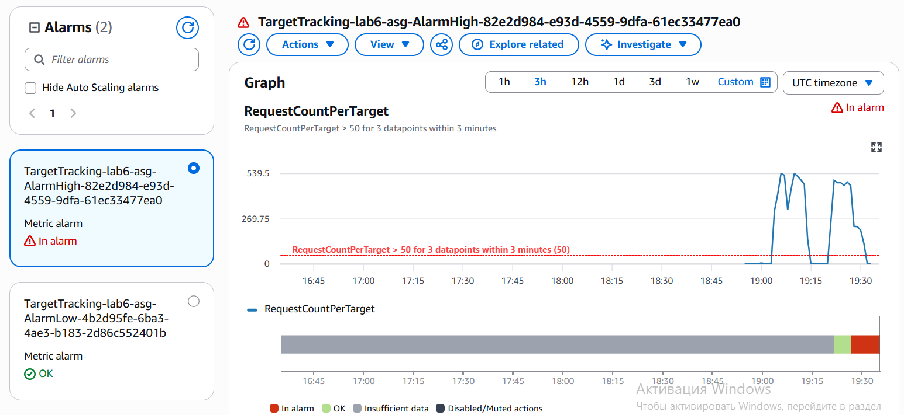](lab6/14-metric-graph.png)

*Рисунок 9 — График `RequestCountPerTarget`: красная пунктирная линия показывает порог 50, после запуска новых серверов метрика падает*

### История тревоги

На вкладке History тревоги `AlarmHigh`: в 19:20:26 UTC тревога создана, в 19:21:44 перешла из Insufficient data в OK, в 19:26:44 из OK в In alarm, и в ту же секунду выполнено действие политики `lab6-request-tracking`.

[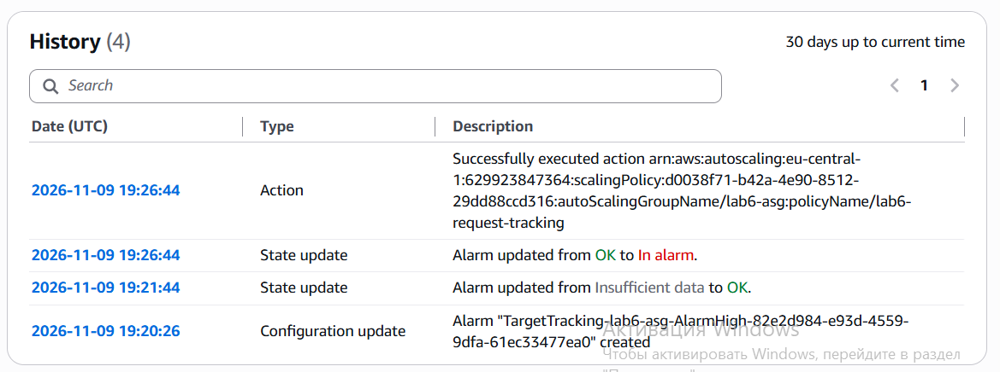](lab6/15-alarm-history.png)

*Рисунок 10 — History тревоги `AlarmHigh`: создание, переход в OK, переход в In alarm и выполнение действия политики масштабирования*

### Рост группы (Activity)

Вкладка Activity группы `lab6-asg` после срабатывания тревоги. В поле Cause указано, что тревога `AlarmHigh` в состоянии ALARM запустила политику `lab6-request-tracking` и изменила желаемую ёмкость с 2 до 4. Запущены два экземпляра: `i-022dc2379f909eec0` и `i-0b16c3aae4e32d544`. Сначала они были в статусе *Waiting for instance warm up* (прогрев), затем Successful.

[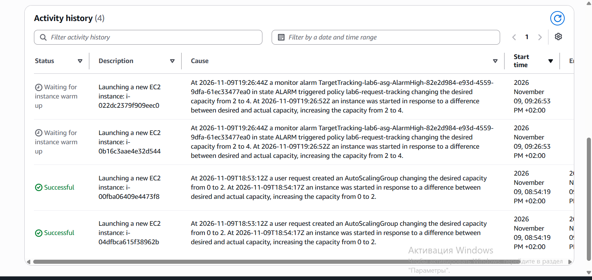](lab6/09-activity-warmup.png)

*Рисунок 11 — Activity: запуск двух новых серверов в 21:26:53 (+02:00, то есть 19:26:53 UTC), статус Waiting for instance warm up*

[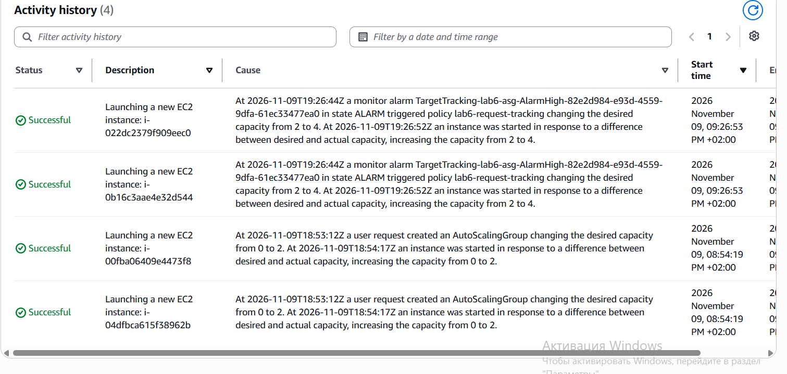](lab6/13-activity-scale-out.png)

*Рисунок 12 — Activity: оба новых сервера в статусе Successful, ниже два сервера, запущенные при создании группы (0 → 2)*

В группе стало 4 экземпляра, все `InService` и `Healthy`, по два в каждой зоне.

[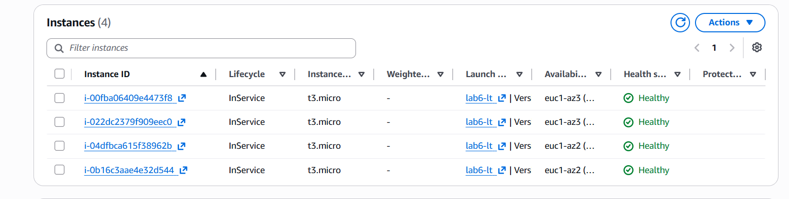](lab6/10-asg-4-instances.png)

*Рисунок 13 — Экземпляры группы: четыре `t3.micro`, все InService и Healthy (две в `euc1-az2`, две в `euc1-az3`)*

Целевая группа `lab6-tg` тоже показывает 4 цели в состоянии `healthy`: по две в `eu-central-1a` и `eu-central-1b`.

[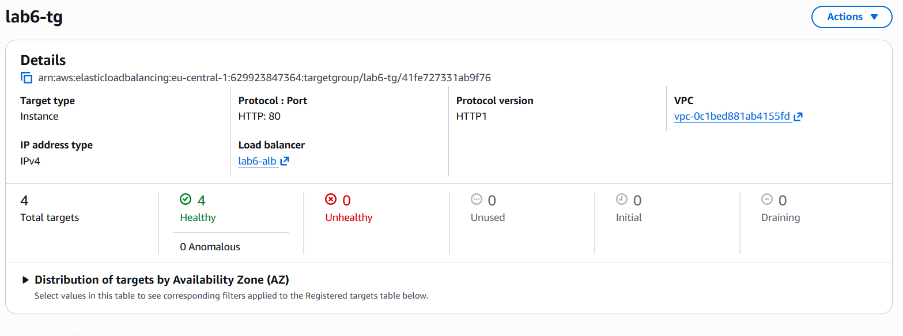](lab6/11-tg-4-healthy.png)

*Рисунок 14 — Целевая группа `lab6-tg`: Total targets 4, Healthy 4, Unhealthy 0*

[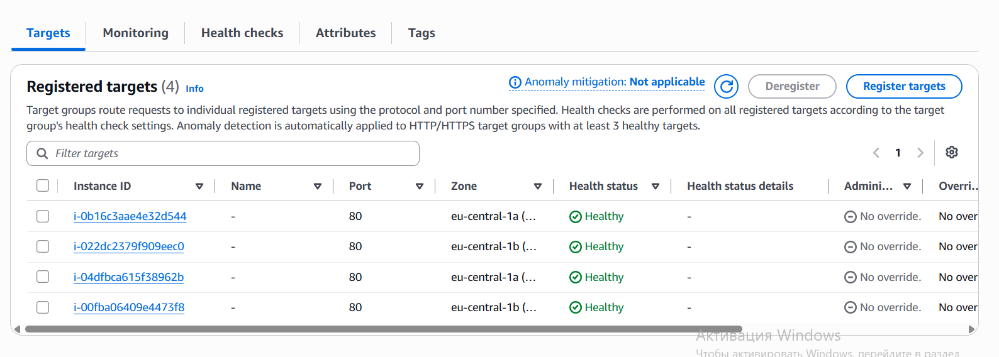](lab6/12-tg-4-targets.png)

*Рисунок 15 — Зарегистрированные цели: `i-0b16c3aae4e32d544` и `i-04dfbca615f38962b` (`eu-central-1a`), `i-022dc2379f909eec0` и `i-00fba06409e4473f8` (`eu-central-1b`), все Healthy*

### Уменьшение группы

После окончания нагрузки метрика упала ниже целевого значения. В 19:35:44 UTC `AlarmHigh` вернулась в OK, а в 19:49:12 UTC в состояние In alarm перешла `AlarmLow`.

[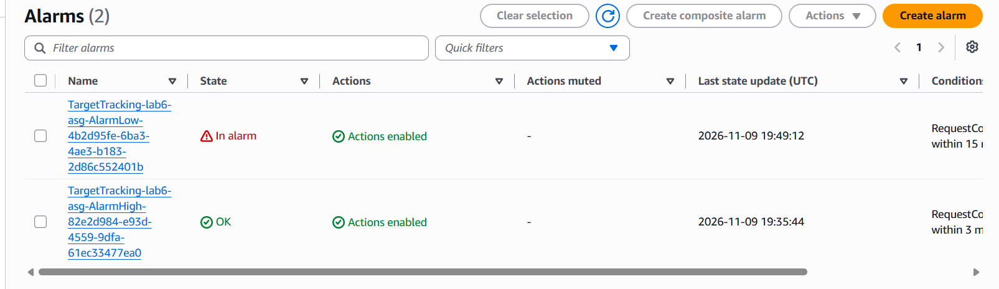](lab6/16-alarms-low-in-alarm.png)

*Рисунок 16 — Список тревог: `AlarmLow` In alarm (последнее изменение 19:49:12 UTC), `AlarmHigh` OK (19:35:44 UTC)*

Группа начала убирать серверы по одному: в 19:49 UTC выбран для завершения `i-04dfbca615f38962b` (желаемая ёмкость 4 → 3), в 19:50 UTC `i-022dc2379f909eec0` (3 → 2). Статус *Connection draining in progress* означает, что сервер уже выведен из обслуживания и ждёт завершения активных соединений.

[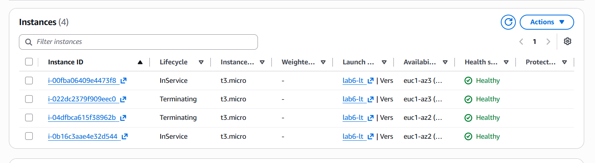](lab6/17-instances-terminating.png)

*Рисунок 17 — В группе два сервера в состоянии Terminating (`i-022dc2379f909eec0`, `i-04dfbca615f38962b`), два остаются InService*

[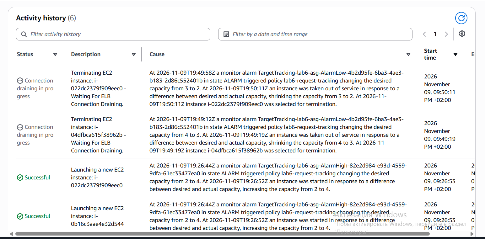](lab6/18-activity-scale-in.png)

*Рисунок 18 — Activity: тревога `AlarmLow` уменьшает желаемую ёмкость с 4 до 3 и с 3 до 2 (Connection draining), ниже виден рост группы*

После этого в группе остались `i-00fba06409e4473f8` (`eu-central-1b`) и `i-0b16c3aae4e32d544` (`eu-central-1a`): по одному серверу в каждой зоне, то есть исходные два сервера.

### Хронология (UTC)

| Время | Событие |
| --- | --- |
| 18:53:12 | Создана группа `lab6-asg`, желаемая ёмкость 0 → 2 |
| 18:54:17 | Запущены два первых сервера |
| 19:20:26 | Созданы тревоги политики target tracking |
| 19:26:44 | `AlarmHigh` → In alarm, политика меняет желаемую ёмкость 2 → 4 |
| 19:26:52 | Запущены два новых сервера (`i-022dc2379f909eec0`, `i-0b16c3aae4e32d544`) |
| 19:35:44 | `AlarmHigh` → OK |
| 19:49:12 | `AlarmLow` → In alarm, желаемая ёмкость 4 → 3 (завершается `i-04dfbca615f38962b`) |
| 19:50:11 | Желаемая ёмкость 3 → 2 (завершается `i-022dc2379f909eec0`) |

### Контрольные вопросы

**Сколько серверов запустила группа и почему не больше четырёх?**

Группа запустила два дополнительных сервера, желаемая ёмкость изменилась с 2 до 4 (рисунки 11 и 12). Больше четырёх она запустить не могла, потому что максимальное количество серверов в группе равно 4. Метрика была примерно в десять раз выше цели (около 540 против 50), поэтому политике для целевого значения потребовалось бы заметно больше серверов, но максимум ограничивает рост. Минимальное и максимальное значения задают границы, за которые политики target tracking выйти не могут. Максимум защищает от неконтролируемых расходов.

**Почему метрика упала после запуска новых серверов, хотя запросов не стало меньше?**

`RequestCountPerTarget` это число запросов, делённое на число целей в целевой группе. Нагрузка от скрипта осталась прежней, но целей стало вдвое больше (4 вместо 2), и общий поток разделился между всеми. Поэтому значение на один сервер упало примерно вдвое (рисунок 9), хотя общее число запросов не изменилось. Запросов на каждый сервер стало меньше, потому что нагрузка распределилась.

**Почему группа добавляет серверы быстрее, чем убирает?**

Это сделано намеренно, потому что ошибки в этих двух направлениях стоят по-разному. Нехватка серверов означает медленные ответы и ошибки для пользователей, поэтому на рост нагрузки группа реагирует сразу: `AlarmHigh` срабатывает по 3 точкам за 3 минуты, и на 19:26:44 группа сразу добавила два сервера. Лишний сервер стоит лишь несколько центов в час, поэтому с уменьшением спешить не нужно: `AlarmLow` оценивает более длинное окно (в списке тревог видно окно в 15 минут), и нужно убедиться, что нагрузка действительно упала надолго, а не на минуту. Кроме того, серверы убираются по одному (4 → 3 → 2), а перед завершением ALB ждёт окончания активных соединений (*Connection draining*). Если бы группа реагировала на спад так же быстро, она бы то добавляла, то убирала серверы при каждом колебании нагрузки. В нашем опыте рост занял около 7 секунд после срабатывания тревоги, а возврат к двум серверам занял около 14 минут после того, как `AlarmHigh` вернулась в OK.

---

## 7. Удаление ресурсов

Балансировщик нельзя остановить, он стоит около $0,9 в сутки, поэтому по окончании занятия ресурсы нужно удалить в таком порядке:

1. Удалить группу `lab6-asg` (вместе с ней завершаются её серверы и удаляются тревоги политики).
2. Удалить балансировщик `lab6-alb` (вместе с listener).
3. Удалить целевую группу `lab6-tg`.
4. Удалить шаблон запуска `lab6-lt`.
5. Проверить в Tag Editor по тегу `Lab = lab6`, что ресурсов не осталось, а в EC2 нет экземпляров, запущенных группой.

---

## 8. Вывод

В ходе работы построена масштабируемая инфраструктура: Application Load Balancer `lab6-alb` в двух публичных подсетях принимает запросы пользователей и передаёт их исправным серверам целевой группы `lab6-tg`, а группа Auto Scaling `lab6-asg` держит от двух до четырёх серверов nginx в двух зонах доступности. Страницы с именем сервера и зоной показали, что запросы действительно попадают на разные серверы в `eu-central-1a` и `eu-central-1b`. Под нагрузкой метрика `RequestCountPerTarget` превысила цель 50, сработала тревога `AlarmHigh`, и группа выросла с двух до четырёх серверов (предел, заданный максимумом). После окончания нагрузки сработала `AlarmLow`, и группа вернулась к двум серверам, при этом рост произошёл быстро, а уменьшение заняло около четырнадцати минут. Серверы принимают HTTP только от балансировщика, а SSH только с bastion.

---

## 9. Список использованных источников

1. Методические материалы лабораторной работы №6, лекция по масштабированию и балансировке нагрузки.
2. Документация AWS: Elastic Load Balancing (Application Load Balancer), Amazon EC2 Auto Scaling (launch templates, target tracking scaling policies), Amazon CloudWatch Alarms.
